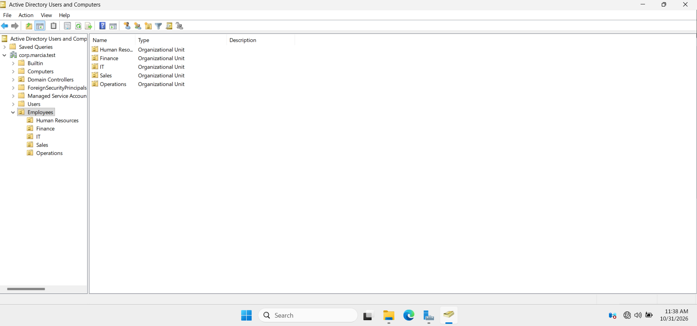
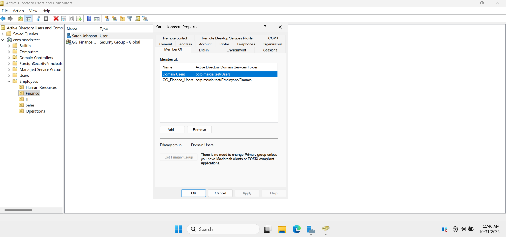
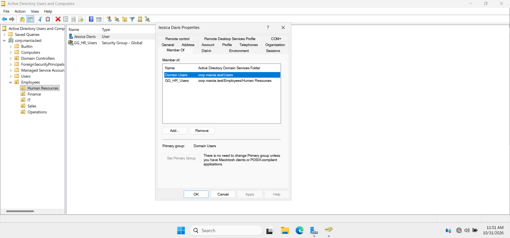

# Lab 01 — Active Directory & Identity Administration

**Project Status:** Completed  
**Environment:** Windows Active Directory & Microsoft Entra ID  
**Focus:** Identity Administration, Security Groups, and Role-Based Access Control

---

## 1. Project Overview

This project demonstrates foundational Identity and Access Management (IAM) administration using Microsoft Active Directory and Microsoft Entra ID.

The goal was to establish a structured identity environment, organize users by department, configure security groups, and validate access assignments.

The project was completed in a personal training environment using simulated employee accounts.

## 2. Business Scenario

A fictional organization needs a centralized process for managing employee identities across its departments.

The organization has five departments:

- Human Resources (HR)
- Finance
- Information Technology (IT)
- Sales
- Operations

As the IAM administrator, my responsibilities include organizing departmental identities, managing security group membership, and establishing a foundation for least-privilege access.

## 3. Tools & Technologies

- Microsoft Active Directory
- Active Directory Users and Computers (ADUC)
- Microsoft Entra ID
- Windows administration tools
- Security groups and organizational units

## 4. Active Directory Organizational Structure

I worked with the Active Directory domain:

`corp.marcia.test`

I organized the directory using departmental organizational units (OUs):

- HR
- Finance
- IT
- Sales
- Operations

**Technical Explanation**

Organizational units help administrators structure and manage directory objects. They can also support delegated administration and Group Policy application.

Organizing identities by department makes the directory easier to maintain as the organization grows.

## 5. Microsoft Entra ID User Administration

I worked with the following test identities:

| User | Lab Purpose |
|---|---|
| Jessica Davis | HR employee identity |
| Michael Brown | IT employee identity |
| Sarah Johnson | Finance employee identity |
| Marcia Lab Admin | Lab administration |
| Marcia Wagner | Test identity |

**Technical Explanation**

Identity administration involves managing user objects and their associated access. Proper account organization provides the foundation for authentication, authorization, and identity lifecycle management.

## 6. Departmental Security Groups

I configured or validated the following Microsoft Entra security group assignments:

| Security Group | Department | Assigned User |
|---|---|---|
| GG_HR_Users | Human Resources | Jessica Davis |
| GG_Finance_Users | Finance | Sarah Johnson |
| GG_IT_Users | IT | Michael Brown |

**Technical Explanation**

Security groups allow organizations to manage access collectively rather than assigning permissions individually to every employee.

This supports role-based access control principles and simplifies employee onboarding, transfers, and offboarding.

Group membership alone does not grant access to a resource unless the group has been assigned the relevant permissions.

## 7. Configuration & Verification

The lab included reviewing the directory structure, examining user identities, and validating departmental security group membership.

The collected evidence supports the following activities:

1. Organizing Active Directory objects by department.
2. Reviewing cloud user identities in Microsoft Entra ID.
3. Configuring departmental security groups.
4. Inspecting group membership assignments.
5. Documenting how identity organization supports access management.

## 8. Security Considerations

### Least Privilege

Access should be assigned according to business responsibilities rather than convenience.

### Group-Based Access

Departmental groups provide a more manageable approach to assigning permissions than individual access assignments.

### Administrative Separation

Administrative accounts should be distinguished from standard employee identities to support controlled privileged access.

### Identity Lifecycle Management

Employee onboarding, department transfers, and departures require regular reviews of group membership and permissions.

## 9. Skills Demonstrated

- Active Directory administration
- Microsoft Entra ID administration
- Organizational unit management
- User identity management
- Security group creation and membership validation
- Role-based access control concepts
- Least-privilege principles
- Technical documentation

## 10. Evidence & Screenshots

The following screenshots were captured during my hands-on Active Directory lab. Each image documents a specific administrative activity and its relevance to identity and access management.

### Evidence 01 — Departmental Organizational Units

**Configuration demonstrated:** An Active Directory organizational structure containing departmental OUs for Human Resources, Finance, IT, Sales, and Operations within the training domain.

**Technical explanation:** Organizational units provide a logical way to organize directory objects. They can support delegated administration and Group Policy application, although creating an OU does not automatically assign permissions.

**Business relevance:** Separating employee identities into departments makes directory administration more manageable and supports consistent identity lifecycle processes.

**Evidence verified:** The screenshot shows the departmental OU structure in Active Directory Users and Computers.

### Evidence 02 — Finance Security Group Membership

**Configuration demonstrated:** Sarah Johnson's membership in the Finance security group, `GG_Finance_Users`, alongside the standard `Domain Users` group.

**Technical explanation:** Security groups allow administrators to manage access for multiple employees collectively. Group membership can support access assignments when the group is granted permissions to a resource.

**Business relevance:** Departmental group assignments simplify onboarding, department transfers, and access reviews while supporting least-privilege principles.

**Evidence verified:** The screenshot shows Sarah Johnson's group memberships in Active Directory Users and Computers. It does not independently establish access to a specific protected resource.

### Evidence 03 — Human Resources Security Group Membership

**Configuration demonstrated:** Jessica Davis's membership in the HR security group, `GG_HR_Users`, alongside the standard `Domain Users` group.

**Technical explanation:** Assigning employees to departmental security groups helps administrators organize identities and manage permissions consistently. Access to individual resources still depends on the permissions assigned to those groups.

**Business relevance:** Consistent group-based administration can reduce unnecessary access and simplify audits or employee access changes.

**Evidence verified:** The screenshot confirms Jessica Davis's departmental group membership. It does not independently demonstrate access to HR applications or files.

### Evidence Summary

| Evidence | Administrative Activity | Verification |
|---|---|---|
| 01 | Departmental OU organization | Five departmental OUs visible |
| 02 | Finance group membership | Sarah Johnson assigned to Finance group |
| 03 | HR group membership | Jessica Davis assigned to HR group |

**Security principle demonstrated:** Organized directory structures and validated group memberships provide a foundation for manageable, auditable identity administration.

## 11. Lessons Learned

This project reinforced the importance of organized identities and security groups in an enterprise IAM environment.

I gained practical experience navigating directory administration tools, examining user and group objects, and understanding how organizational structures support access control.

These foundational skills support more advanced IAM activities, including Conditional Access, access reviews, provisioning, and privileged access management.

---

**Project Type:** Independent hands-on IAM training lab  
**Portfolio Owner:** Marcia Wagner
