# Lab 02 — Microsoft Entra ID & Conditional Access

**Project Status:** Completed  
**Environment:** Microsoft Entra ID  
**Focus:** Cloud Identity Administration, Multifactor Authentication (MFA), Conditional Access, and Security Policy Validation

---

## 1. Project Overview

This project demonstrates cloud identity administration and access security using Microsoft Entra ID.

I configured departmental identities and security groups, explored authentication security settings, created three Conditional Access policies, and evaluated their behavior using Microsoft's What If simulation tool.

All three Conditional Access policies were configured in **report-only mode**, allowing me to test policy applicability without enforcing access restrictions on live users.

## 2. Business Scenario

A fictional organization wants to strengthen access security across three departments:

- **IT:** Require Microsoft Authenticator MFA.
- **Finance:** Restrict access originating outside the United States.
- **Human Resources:** Restrict access from non-Windows devices.

As the IAM administrator, my responsibilities were to configure the security controls, evaluate their applicability, and document the results before any production enforcement.

## 3. Tools & Technologies

- Microsoft Entra Admin Center
- Microsoft Entra ID
- Microsoft Authenticator
- Conditional Access
- Authentication strengths
- Named locations
- Conditional Access What If tool
- Cloud security groups

## 4. Cloud Identity Administration

I worked with the following test identities:

| User | Department / Purpose |
|---|---|
| Jessica Davis | Human Resources |
| Michael Brown | Information Technology |
| Sarah Johnson | Finance |
| Marcia Lab Admin | Administrative test account |
| Marcia Wagner | Lab identity |

I reviewed the following departmental security groups:

| Security Group | Assigned Test User |
|---|---|
| GG_HR_Users | Jessica Davis |
| GG_IT_Users | Michael Brown |
| GG_Finance_Users | Sarah Johnson |

**Technical Explanation**

Security groups allow organizations to target access controls according to business responsibilities rather than applying identical restrictions to every user.

Using departmental groups also makes access policies easier to maintain when employee responsibilities change.

## 5. Authentication Security Configuration

I reviewed Microsoft Entra authentication methods and configured Microsoft Authenticator settings, including push notification security features and a registration campaign targeting the IT security group.

I also created a custom authentication strength:

`IAM-Lab-Authenticator-MFA`

This authentication strength was configured to allow password plus Microsoft Authenticator push authentication.

**Security Objective:** Establish a defined authentication requirement that could be referenced by a Conditional Access policy.

## 6. Conditional Access Policy 01 — IT MFA Requirement

**Policy Name:** `CA-01-IT-Require-Authenticator-MFA`

**Configuration:**

- Target group: `GG_IT_Users`
- Excluded account: Marcia Lab Admin
- Target resources: All resources
- Grant control: Require authentication strength
- Authentication strength: `IAM-Lab-Authenticator-MFA`
- Policy state: Report-only

**Business Purpose**

Require IT employees to meet a defined MFA requirement when accessing organizational resources.

**Testing and Results**

I used the What If tool to evaluate an IT employee scenario involving Michael Brown.

The simulation showed that the policy applied to the targeted IT identity.

Testing a user outside the IT group showed that the policy did not apply because the user was outside the targeted user/group scope.

**Verified Outcome:** The policy's group targeting and authentication-strength requirement were evaluated successfully through simulation.

## 7. Conditional Access Policy 02 — Finance Geographic Restriction

**Policy Name:** `CA-02-Finance-Block-Non-US-Access`

**Named Location:** `IAM-Lab-United-States`

**Configuration:**

- Target group: `GG_Finance_Users`
- Excluded account: Marcia Lab Admin
- Target resources: All resources
- Network conditions: Include any location; exclude the named United States location
- Grant control: Block access
- Policy state: Report-only

**Business Purpose**

Restrict Finance department access attempts originating outside the organization's permitted geographic area.

**Testing and Results**

I evaluated Finance sign-in scenarios using the Conditional Access What If tool.

| Test Scenario | Simulation Result |
|---|---|
| Finance user accessing from the United States | Finance restriction not applicable because of the location exclusion |
| Finance user accessing from outside the United States | Finance block policy applicable |
| IT user accessing from outside the United States | Finance block policy not applicable because the user was outside the targeted Finance group |

**Verified Outcome:** The What If simulations demonstrated how the geographic condition and departmental group targeting affected policy applicability.

These were simulated outcomes, not actual blocked sign-ins.

## 8. Conditional Access Policy 03 — HR Device Platform Restriction

**Policy Name:** `CA-03-HR-Block-Non-Windows-Devices`

**Configuration:**

- Target group: `GG_HR_Users`
- Excluded account: Marcia Lab Admin
- Target resources: All resources
- Device platforms: Include any device; exclude Windows
- Grant control: Block access
- Policy state: Report-only

**Business Purpose**

Evaluate a restriction designed to prevent HR users from accessing company resources using non-Windows platforms.

**Testing and Results**

| Test Scenario | Simulation Result |
|---|---|
| HR user accessing from Windows | HR restriction not applicable because Windows was excluded |
| HR user accessing from a non-Windows platform | HR block policy applicable |

**Verified Outcome:** Simulation results demonstrated that device platform conditions affected the policy's applicability.

A device-platform condition is not the same as verifying that a device is managed or compliant.

## 9. Conditional Access Validation

I evaluated the policies using the Microsoft Entra What If tool, including positive and negative test conditions involving department membership, geographic location, and device platform.

The test scenarios helped demonstrate:

1. Targeted policies apply to users within their assigned groups.
2. Users outside a targeted group may be excluded from that policy.
3. Geographic conditions affect Finance policy applicability.
4. Device platform conditions affect HR policy applicability.
5. Report-only mode allows administrators to evaluate policy behavior without enforcing it.

**Important:** The What If tool simulates policy applicability. It does not independently demonstrate successful MFA completion, real access denial, or enforcement on an actual sign-in.

## 10. Security Considerations

### Least Privilege and Department-Based Controls

Different departments may require different authentication and access restrictions depending on business responsibilities.

### Administrative Account Exclusion

The lab administrator was excluded from the tested policies to reduce the possibility of administrative lockout during configuration.

### Controlled Policy Rollout

Report-only mode provides an opportunity to evaluate policies before administrators consider enforcement.

### Geographic and Device-Based Restrictions

Location and device platform restrictions can contribute to access security, but they do not replace broader authentication, device compliance, and security monitoring controls.

## 11. Evidence & Screenshots

The following 22 screenshots document identity administration, authentication configuration, Conditional Access policy design, and simulated security validation in my Microsoft Entra ID training environment.

All three Conditional Access policies were configured in **report-only mode**. What If results demonstrate simulated policy applicability, not enforced access restrictions.

### Evidence 01 — Microsoft Entra Cloud Users

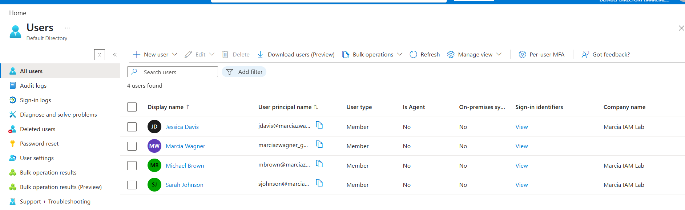

**Configuration demonstrated:** Microsoft Entra user inventory containing the test identities used throughout the lab.

**Technical explanation:** Cloud identities provide the foundation for authentication, group membership, and access policy assignments.

**Business relevance:** Centralized identity administration supports employee onboarding, identity maintenance, and access governance.

**Evidence verified:** The screenshot documents the test user accounts available in the Entra environment.

### Evidence 02 — Departmental Security Groups

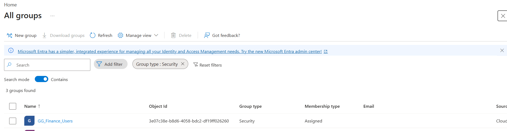

**Configuration demonstrated:** Departmental security groups for IT, Finance, and Human Resources.

**Technical explanation:** Security groups allow Conditional Access policies to target specific collections of users rather than the entire organization.

**Business relevance:** Department-specific targeting supports different security requirements based on business responsibilities.

**Evidence verified:** The configured departmental security groups are visible.

### Evidence 03 — Finance Group Membership

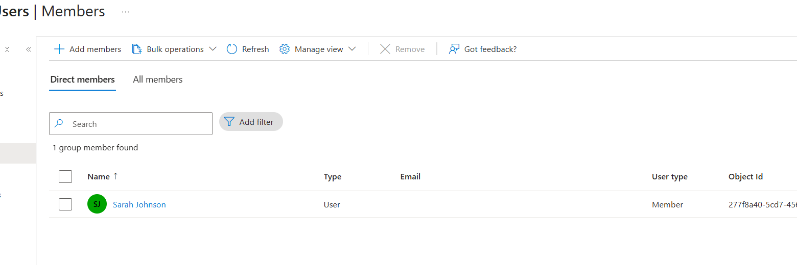

**Configuration demonstrated:** Finance test identity Sarah Johnson associated with the Finance security group.

**Technical explanation:** Group membership determines whether a user falls within the user scope of a group-targeted Conditional Access policy.

**Business relevance:** Finance employees can be assigned additional geographic access restrictions.

**Evidence verified:** The screenshot documents Finance group membership in the lab.

### Evidence 04 — Human Resources Group Membership

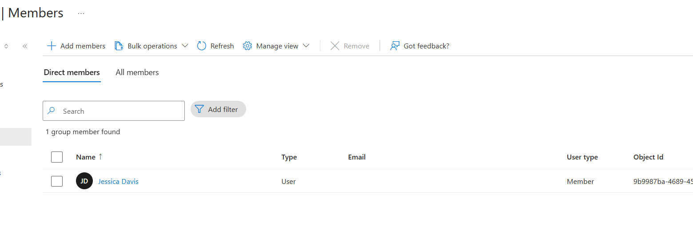

**Configuration demonstrated:** Human Resources test identity Jessica Davis associated with the HR security group.

**Technical explanation:** HR group membership provides the identity targeting used by the department's device-platform Conditional Access policy.

**Business relevance:** Departmental security controls can be applied consistently using group-based assignments.

**Evidence verified:** The screenshot documents HR group membership.

### Evidence 05 — Information Technology Group Membership

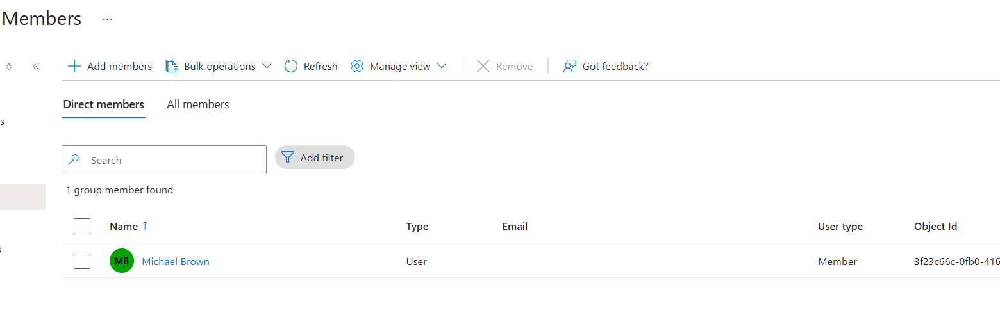

**Configuration demonstrated:** IT test identity Michael Brown associated with the IT security group.

**Technical explanation:** Group-based identity targeting allows the IT authentication policy to apply to relevant users.

**Business relevance:** IT accounts may require stronger authentication controls because of their responsibilities.

**Evidence verified:** The screenshot documents IT group membership.

### Evidence 06 — Microsoft Entra Authentication Methods

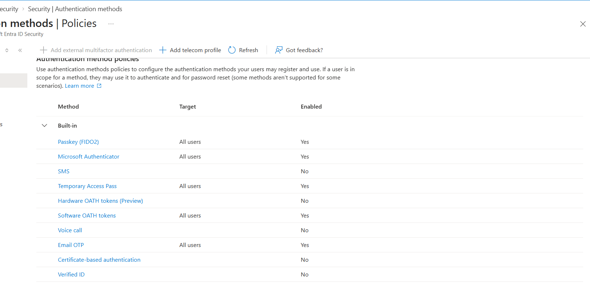

**Configuration demonstrated:** Microsoft Entra authentication-method settings reviewed during the MFA portion of the lab.

**Technical explanation:** Authentication-method policies govern which authentication options are available to targeted users.

**Business relevance:** Standardized authentication settings help organizations manage authentication security consistently.

**Evidence verified:** The screenshot records the authentication-method configuration examined in the training environment.

### Evidence 07 — Microsoft Authenticator Registration Campaign

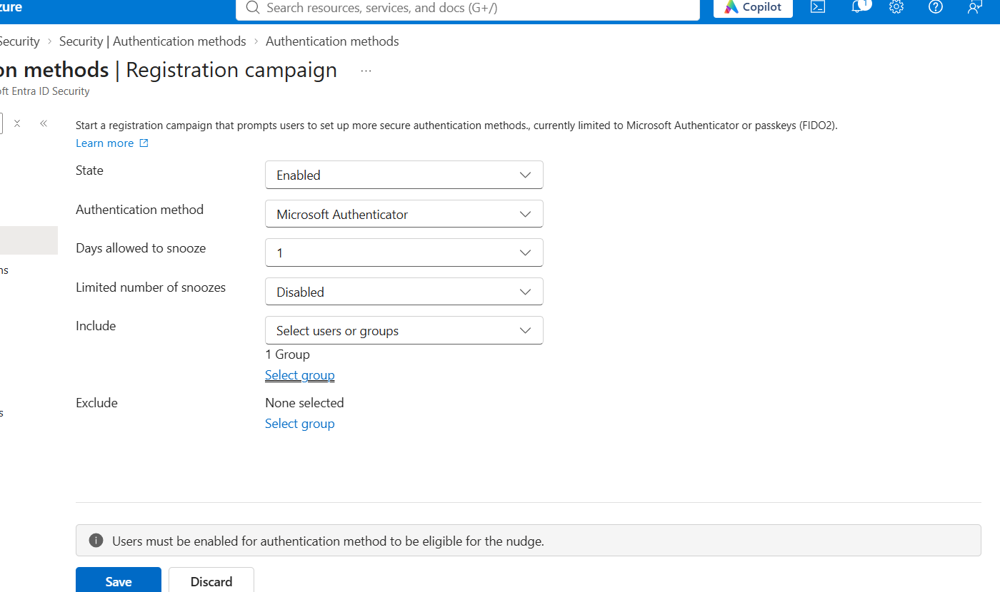

**Configuration demonstrated:** Microsoft Authenticator registration-campaign settings targeting the IT security group.

**Technical explanation:** Registration campaigns encourage users to register supported authentication methods.

**Business relevance:** Organizations can encourage adoption of stronger authentication without relying exclusively on manual enrollment instructions.

**Evidence verified:** The screenshot documents the registration-campaign configuration.

### Evidence 08 — Custom MFA Authentication Strength

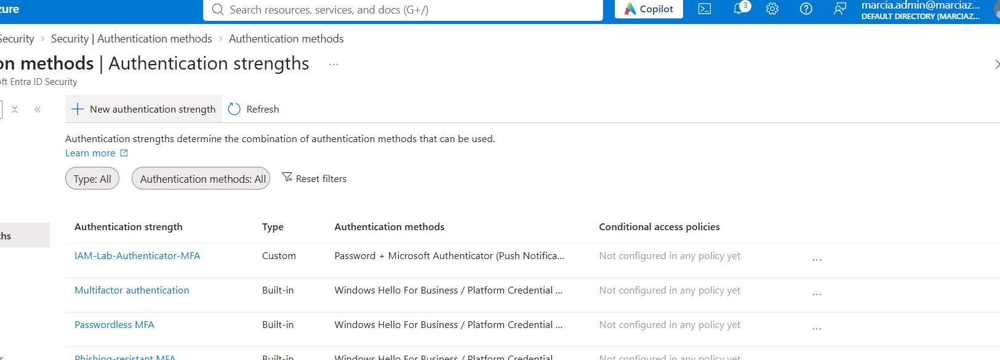

**Configuration demonstrated:** Custom authentication strength `IAM-Lab-Authenticator-MFA`.

**Technical explanation:** The custom authentication strength specifies password plus Microsoft Authenticator push as an allowed authentication combination.

**Business relevance:** Defined authentication requirements help standardize expectations for targeted employees.

**Evidence verified:** The screenshot documents the custom authentication-strength configuration.

### Evidence 09 — IT Conditional Access Policy Configuration

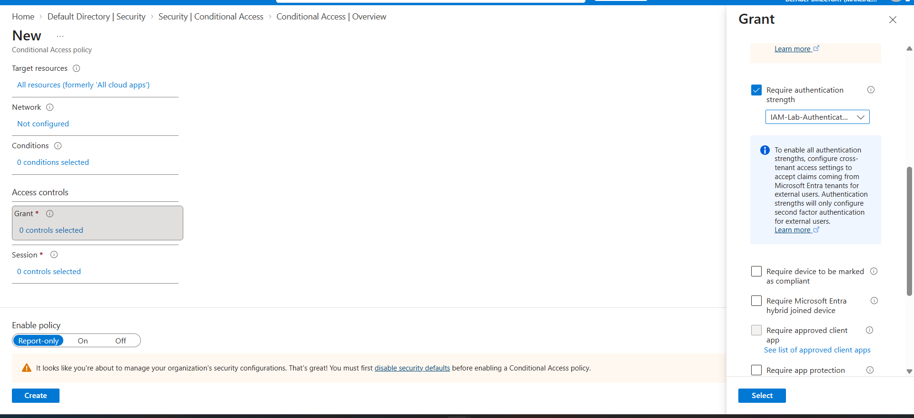

**Policy:** `CA-01-IT-Require-Authenticator-MFA`

**Configuration demonstrated:** Conditional Access policy targeting the IT security group and requiring the custom authentication strength.

**Technical explanation:** User-group assignments determine the policy scope, while grant controls define the authentication requirement.

**Business relevance:** Stronger authentication can be targeted to employees with elevated security responsibilities.

**Evidence verified:** The screenshot records the IT policy configuration.

### Evidence 10 — IT Policy Report-Only State

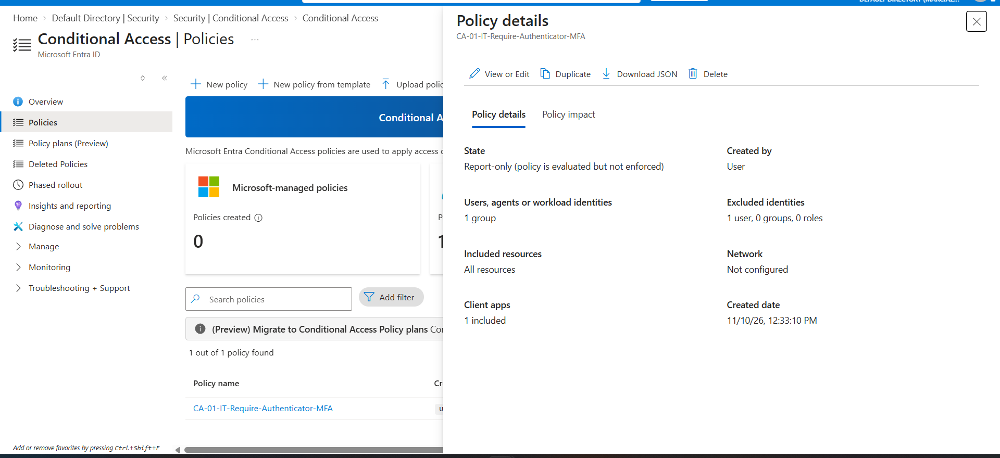

**Configuration demonstrated:** The IT authentication policy configured in report-only mode.

**Technical explanation:** Report-only mode permits policy evaluation without enforcing the configured requirement during sign-in.

**Business relevance:** Administrators can assess potential policy behavior before considering an enforcement rollout.

**Evidence verified:** The screenshot documents the policy state.

### Evidence 11 — IT Policy Negative What If Test

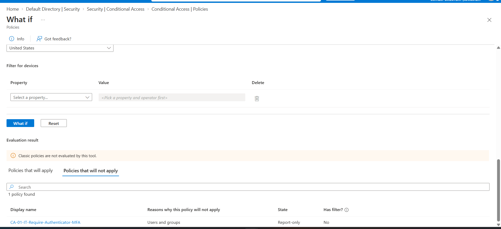

**Test scenario:** Evaluate the IT MFA policy against a user outside the targeted IT group.

**Technical explanation:** The What If evaluation reported that the policy did not apply because the tested identity was outside its user/group scope.

**Business relevance:** Negative testing helps confirm that departmental controls are not inadvertently targeted at unrelated employees.

**Evidence verified:** The simulation demonstrates the non-targeted user condition.

### Evidence 12 — IT Policy Positive What If Test

**Test scenario:** Evaluate the policy against Michael Brown, an IT group member.

**Technical explanation:** The What If result identified the IT Conditional Access policy as applicable and reflected its configured authentication-strength requirement.

**Business relevance:** Positive testing helps confirm that the intended employee group falls within the proposed policy scope.

**Evidence verified:** The simulation demonstrates policy applicability for the targeted IT identity. It does not prove successful MFA completion.

### Evidence 13 — United States Named Location

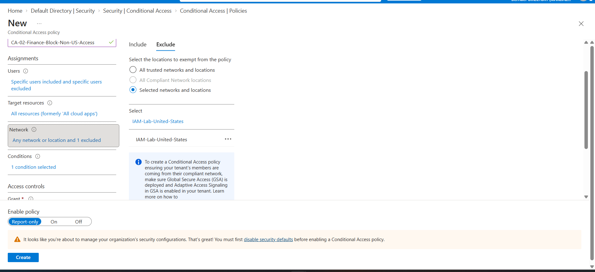

**Configuration demonstrated:** Named location `IAM-Lab-United-States`.

**Technical explanation:** The named location identifies United States country-based IP locations for use in Conditional Access network conditions.

**Business relevance:** Named locations allow organizations to define geographic conditions within access policies.

**Evidence verified:** The screenshot documents the named-location configuration.

### Evidence 14 — Finance Conditional Access Scope

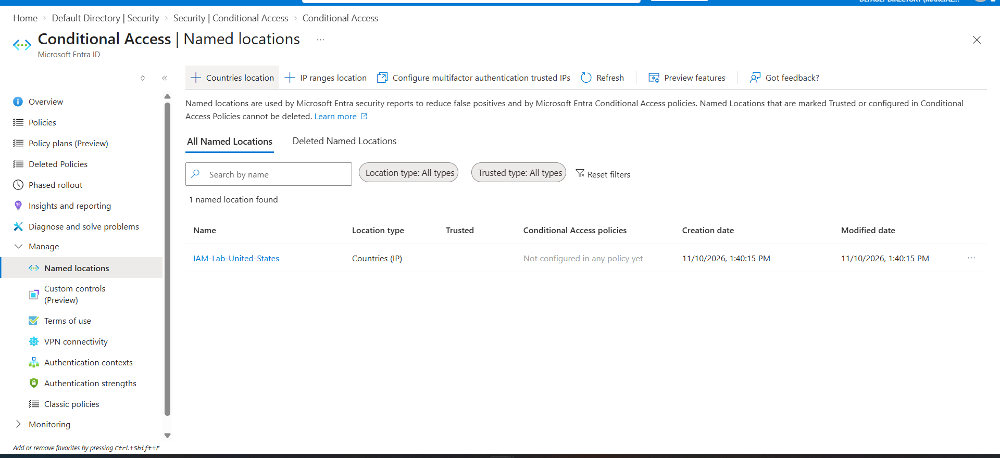

**Policy:** `CA-02-Finance-Block-Non-US-Access`

**Configuration demonstrated:** Finance group targeting for the geographic access restriction.

**Technical explanation:** The policy includes any network location, excludes the defined United States location, and specifies a block-access grant control.

**Business relevance:** Finance access restrictions can be evaluated against geographic requirements.

**Evidence verified:** The screenshot documents the Finance policy's targeting configuration.

### Evidence 15 — Finance Policy Report-Only State

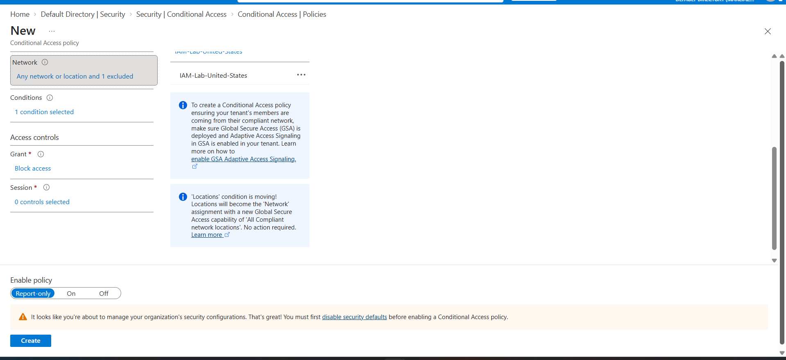

**Configuration demonstrated:** The Finance geographic restriction configured in report-only mode.

**Technical explanation:** The block-access control is configured but not actively enforced while the policy remains report-only.

**Business relevance:** Simulated testing helps assess geographic restrictions without disrupting access.

**Evidence verified:** The screenshot documents the Finance policy state.

### Evidence 16 — Finance United States Location Test

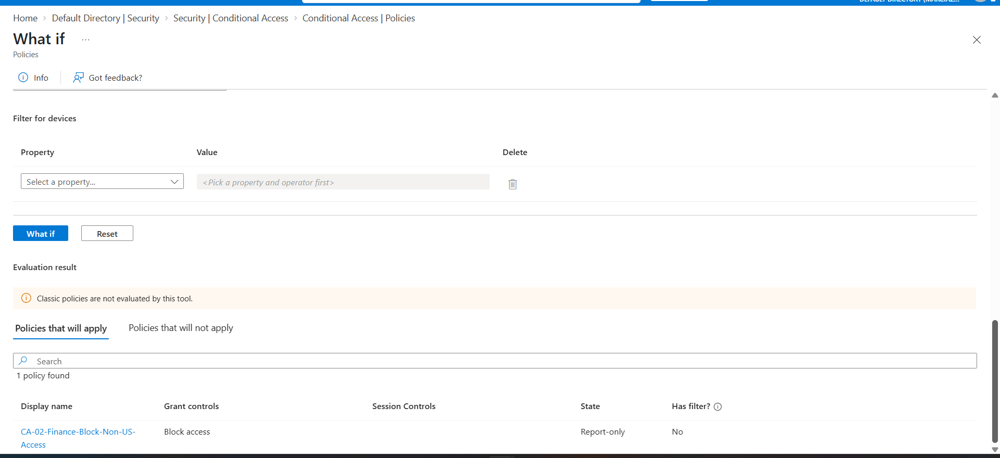

**Test scenario:** Evaluate a Finance sign-in originating from the United States.

**Technical explanation:** The What If result showed the Finance geographic block policy was not applicable because the simulated location matched the excluded United States condition.

**Business relevance:** Testing permitted geographic conditions helps identify whether restrictions are scoped as intended.

**Evidence verified:** The simulation demonstrates the location-exclusion behavior.

### Evidence 17 — Finance Non-US Location Test

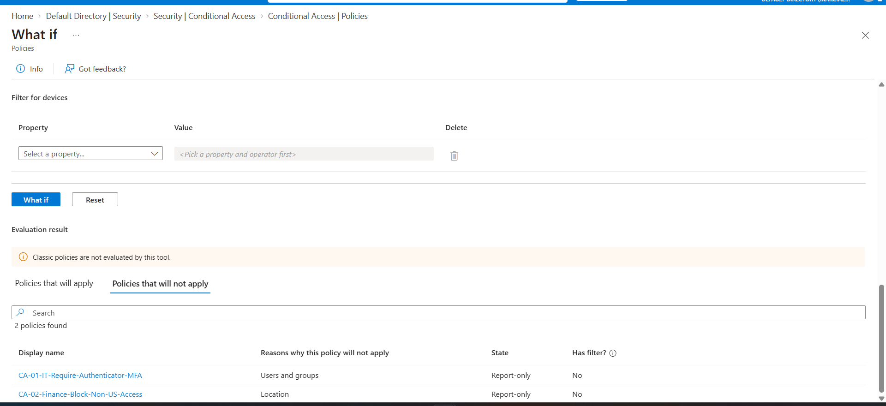

**Test scenario:** Evaluate a Finance sign-in originating outside the United States.

**Technical explanation:** The What If result showed that the geographic block policy was applicable to the targeted Finance identity under the simulated non-US condition.

**Business relevance:** Positive restriction testing helps validate whether the proposed geographic rule addresses the intended risk scenario.

**Evidence verified:** The simulation identifies the configured block policy as applicable. No real sign-in was blocked during this test.

### Evidence 18 — Finance Policy Tested Against IT User

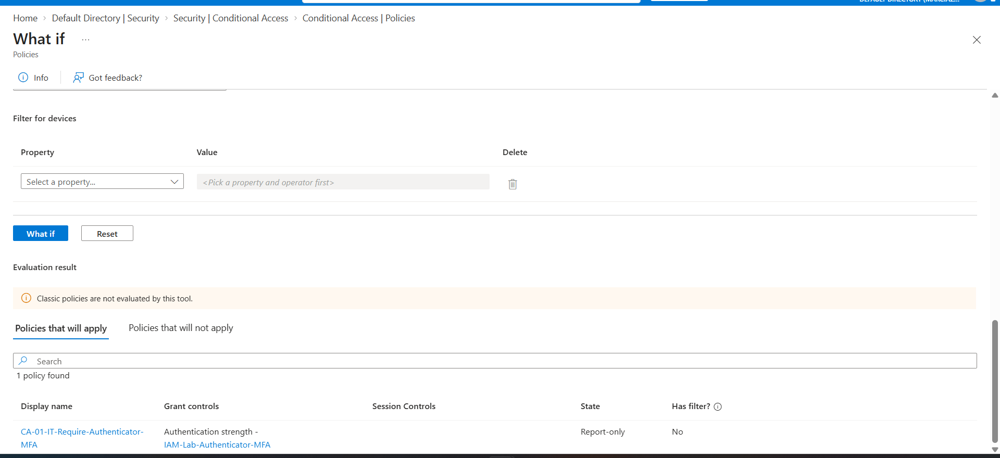

**Test scenario:** Evaluate an IT employee under a non-US location condition.

**Technical explanation:** The Finance block policy did not apply to the IT employee because the tested identity was not a member of the targeted Finance group.

**Business relevance:** Cross-department testing helps identify unintended policy targeting.

**Evidence verified:** The simulation demonstrates that the Finance policy's user/group scope excludes the IT test identity.

### Evidence 19 — HR Device Platform Policy Configuration

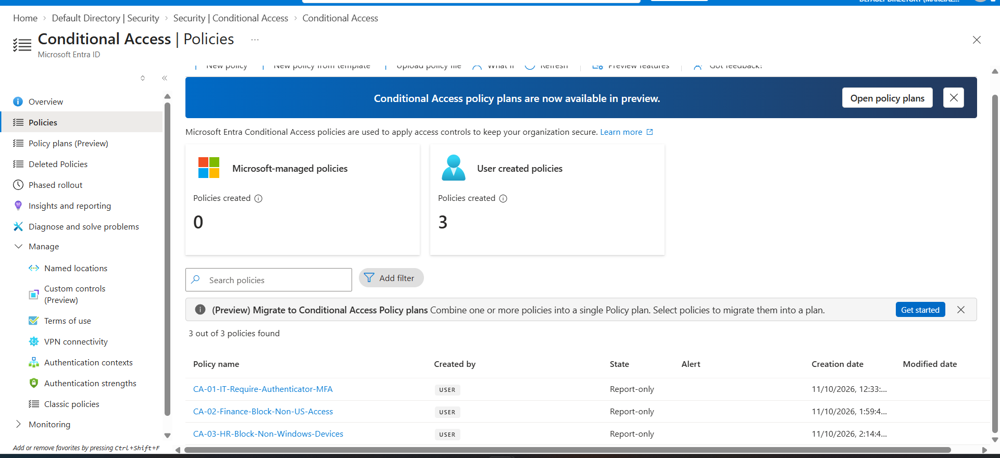

**Policy:** `CA-03-HR-Block-Non-Windows-Devices`

**Configuration demonstrated:** HR Conditional Access policy targeting non-Windows device platforms.

**Technical explanation:** The policy includes device platforms generally, excludes Windows, and specifies block access for applicable conditions.

**Business relevance:** Device-platform restrictions can help organizations evaluate departmental access requirements.

**Evidence verified:** The screenshot documents the HR device-platform policy configuration.

### Evidence 20 — Conditional Access Policy Inventory

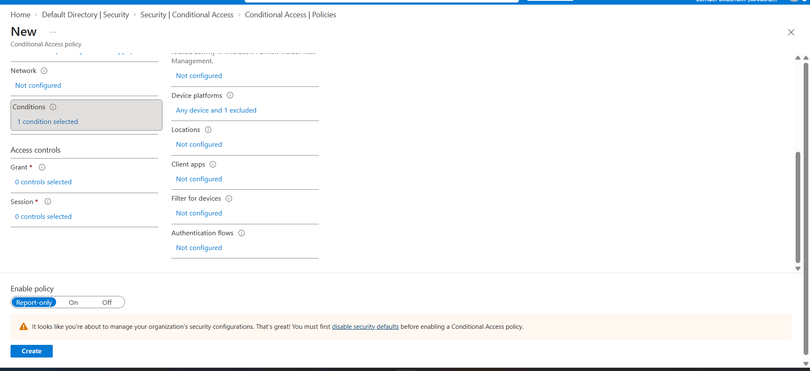

**Configuration demonstrated:** Conditional Access policy inventory containing the IT, Finance, and HR policies.

**Technical explanation:** Reviewing the policy inventory helps administrators verify policy names, states, and overall configuration coverage.

**Business relevance:** Centralized policy review supports security administration and configuration oversight.

**Evidence verified:** The screenshot documents the three lab policies and their report-only configuration.

### Evidence 21 — HR Windows Device Test

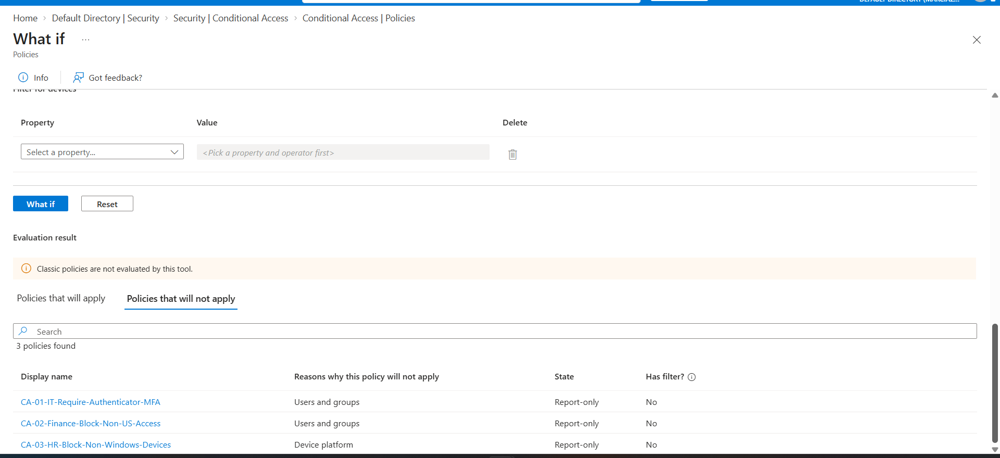

**Test scenario:** Evaluate an HR employee using the Windows device platform.

**Technical explanation:** The What If result indicated that the HR block policy did not apply because Windows was excluded from the device-platform condition.

**Business relevance:** Testing exception conditions helps verify that proposed policies do not unintentionally include allowed platforms.

**Evidence verified:** The simulation demonstrates the configured Windows platform exclusion.

### Evidence 22 — HR Non-Windows Device Test

**Test scenario:** Evaluate an HR employee using a non-Windows device platform.

**Technical explanation:** The What If result identified the HR block policy as applicable under the simulated non-Windows condition.

**Business relevance:** Evaluating restricted platforms helps confirm that a proposed departmental control addresses its intended access scenario.

**Evidence verified:** The simulation identifies the configured block-access rule as applicable. It does not demonstrate an actual denied sign-in.

### Evidence Summary

Together, these screenshots document cloud identity administration, departmental security groups, authentication-method configuration, custom MFA requirements, and three Conditional Access policies.

The positive and negative What If evaluations support the documented policy-scoping decisions.

**Validation limitation:** Because the policies remained in report-only mode, the simulations do not establish that access was blocked, that MFA was completed, or that device compliance was verified in a live sign-in.

## 12. Skills Demonstrated

- Microsoft Entra ID administration
- Cloud user and group management
- Microsoft Authenticator configuration
- Multifactor authentication concepts
- Custom authentication strengths
- Conditional Access policy configuration
- Named locations
- Group-based policy targeting
- Geographic and device platform conditions
- What If security policy testing
- Report-only policy validation
- Technical documentation

## 13. Lessons Learned

This project strengthened my understanding of how Microsoft Entra ID evaluates access policies using users, groups, authentication requirements, locations, and device conditions.

I learned how to design departmental Conditional Access policies, compare expected and simulated behavior, and document outcomes without confusing simulated security decisions with enforced production restrictions.

The project also reinforced the importance of testing access policies before enforcement to reduce unintended business disruption.

---

**Project Type:** Independent hands-on IAM training lab  
**Portfolio Owner:** Marcia Wagner
