# Lab 03 — Identity Governance & Access Reviews

**Project Status:** Completed  
**Environment:** Microsoft Entra ID — Personal Training Tenant  
**Focus:** Access Recertification, Identity Governance, Least Privilege, and Access Remediation  
**Completion Date:** November 10, 2026

---

## 1. Project Overview

This project demonstrates how identity governance processes can help organizations review employee access, identify unnecessary permissions, and remove access that is no longer justified by business responsibilities.

I configured and completed a Microsoft Entra ID access review for a Finance security group. Using a simulated employee department-transfer scenario, I evaluated the employee's continued need for access, recorded a denial decision, applied the review results, and independently verified that the employee was removed from the Finance group.

Unlike a theoretical access review, this exercise included an actual membership removal in my training environment.

## 2. Business Scenario

A fictional organization conducts periodic access recertification to ensure employees retain only the access required for their assigned responsibilities.

Sarah Johnson, a Finance group member, was used in a simulated scenario in which she transferred from Finance to Human Resources.

Following the simulated transfer, Sarah no longer had a business need for Finance group access.

**Security concern:** Retaining unnecessary Finance access could expose sensitive business resources and conflict with least-privilege principles.

**Objective:** Conduct an access recertification review, document the decision, remove unnecessary group membership, and verify the outcome.

The department transfer was a business scenario, not a change made to Sarah's actual department or HR group membership.

## 3. Tools and Technologies

- Microsoft Entra ID
- Microsoft Entra Identity Governance
- Access Reviews
- Microsoft Entra Security Groups
- My Access review interface
- Access review decision and result-management features

## 4. Identity and Group Scope

**Access review name:** `AR-01-Finance-Access-Recertification`

**Target group:** `GG_Finance_Users`

**Reviewed identity:** Sarah Johnson

**Reviewer:** Marcia Lab Admin

**Review type:** Group membership access review

**Review frequency:** One-time

The review targeted the Finance group's membership rather than all users or all applications in the tenant.

## 5. Access Review Configuration

I created the Finance access recertification review with the following settings:

| Setting | Configuration |
|---|---|
| Review name | `AR-01-Finance-Access-Recertification` |
| Resource | `GG_Finance_Users` |
| Review scope | All users in the selected group |
| Reviewer | Marcia Lab Admin |
| Frequency | One time |
| Review period | November 10–11, 2026 |
| Duration | 1 day |
| Auto-apply results | Disabled |
| No-response action | No change |
| Decision helper | No sign-in within 30 days |
| Require justification | Enabled |
| Email notifications | Enabled |
| Email reminders | Enabled |

**Security rationale:** Disabling automatic application allowed the review decision and subsequent remediation to be handled deliberately.

Requiring a justification supported accountability by recording the reason for the decision.

## 6. Review Execution

After creating the access review, I accessed the assigned review through the My Access interface.

The review displayed Sarah Johnson as the identity requiring recertification.

The recommendation shown in the interface was **Deny**, based on the configured inactivity-related decision helper.

I evaluated the recommendation against the simulated business scenario and made a manual decision to deny continued Finance membership.

**Decision:** Deny

**Business justification:** Sarah Johnson was treated as having transferred from Finance to Human Resources and therefore no longer required Finance group access.

This decision was made manually rather than relying solely on the automated recommendation.

## 7. Review Completion

After submitting the decision, the review showed that its single user had been reviewed.

The review was then stopped and marked complete.

Because the review was configured with automatic application disabled, completing the review did not by itself remove the membership.

The application of results was handled as a separate administrative action.

## 8. Applying Access Review Results

I manually applied the completed access review results in Microsoft Entra ID.

The results interface reported:

**Status:** Success

**Action:** Successfully removed from membership

**Applied by:** Marcia Lab Admin

**Date:** November 10, 2026

This established that the denied access decision had been applied to the Finance group membership in the training environment.

## 9. Independent Membership Verification

To verify the remediation independently of the review results page, I navigated to the Finance security group in Microsoft Entra ID.

**Group:** `GG_Finance_Users`

**Location:** Members → Direct members

The membership view displayed:

`0 group members found`

`No members have been found`

This confirmed that Sarah Johnson's direct membership in the Finance group had been removed.

The verification establishes the group membership outcome, not the status of every possible permission or resource assignment elsewhere in the tenant.

## 10. Security Analysis and Business Relevance

### Access Recertification

Access reviews support periodic reassessment of whether users still require the access they hold.

### Least Privilege

The scenario demonstrates removing group membership when it is no longer justified by an employee's assigned responsibilities.

### Separation of Decision and Remediation

A review decision and the application of that decision are distinct steps when automatic application is disabled.

### Auditability

Documenting the reviewer, denial justification, review status, application result, and follow-up verification provides a traceable record of administrative actions.

### Verification

Checking the group's membership after applying results provides stronger evidence of remediation than relying solely on the recorded decision.

## 11. Evidence & Screenshots

The following 12 screenshots document the configuration, execution, completion, and verification of a Microsoft Entra ID access recertification review in my personal training environment.

The scenario involved a simulated Finance-to-HR employee transfer. The access review, denial decision, application of results, and Finance group membership removal were actual administrative actions performed in the lab tenant.

### Evidence 01 — Access Review Scope

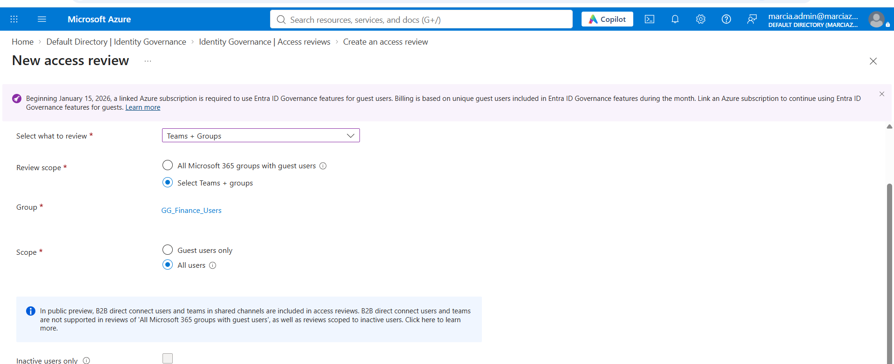

**Configuration demonstrated:** Access review `AR-01-Finance-Access-Recertification` targeting the `GG_Finance_Users` security group.

**Technical explanation:** The review resource and scope determine which access assignments are evaluated. Limiting the review to Finance group membership focuses the process on a specific set of permissions.

**Business relevance:** Targeted recertification helps organizations assess whether department-specific access remains appropriate.

**Evidence verified:** The screenshot documents the selected Finance group and review scope.

### Evidence 02 — Reviewer Assignment and Schedule

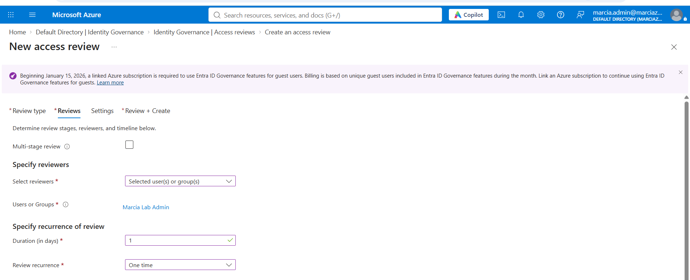

**Configuration demonstrated:** Review assignment to Marcia Lab Admin, with a one-time review scheduled for November 10–11, 2026.

**Technical explanation:** Reviewer assignments establish responsibility for access decisions, while review scheduling defines the period during which decisions are collected.

**Business relevance:** Assigned ownership and review deadlines support consistent access governance.

**Evidence verified:** The screenshot documents the reviewer and review scheduling settings.

### Evidence 03 — Review Completion Safeguards

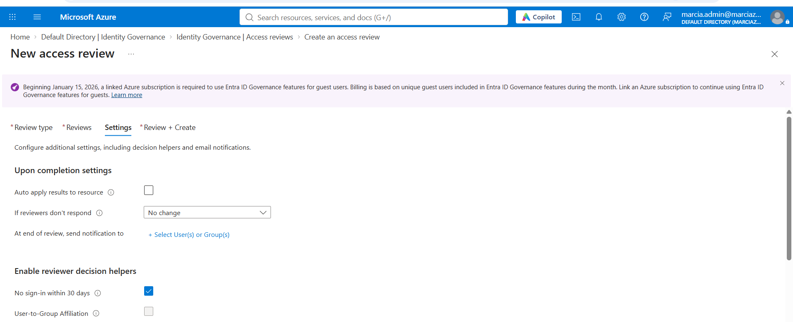

**Configuration demonstrated:** Automatic application disabled, no-response action set to No change, and the inactivity-related decision helper configured.

**Technical explanation:** With automatic application disabled, review decisions require a separate administrative application step before membership changes take effect.

**Business relevance:** Separating review decisions from remediation allows administrators to validate outcomes before modifying access.

**Evidence verified:** The screenshot documents the configured review completion safeguards.

### Evidence 04 — Audit and Notification Settings

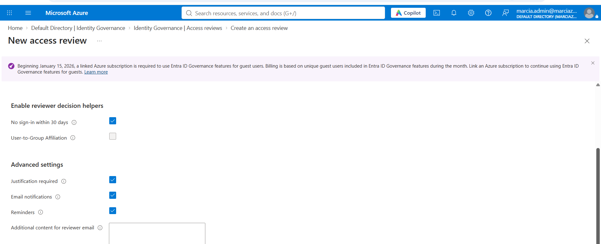

**Configuration demonstrated:** Justification requirement enabled, with email notifications and reminders configured.

**Technical explanation:** Required decision justifications capture the reviewer's reasoning. Notifications and reminders support review participation.

**Business relevance:** Documented decisions and administrative reminders improve accountability and governance process consistency.

**Evidence verified:** The screenshot documents the configured justification and notification options.

### Evidence 05 — Access Review Created

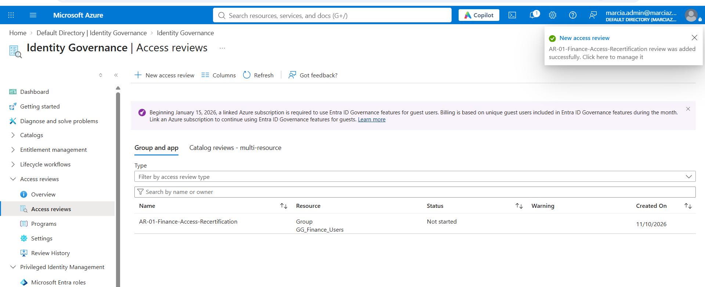

**Configuration demonstrated:** Finance access recertification review successfully created in Microsoft Entra ID.

**Technical explanation:** Creating the review establishes a governance workflow for evaluating access assignments associated with the targeted resource.

**Business relevance:** Access recertification workflows help organizations periodically reassess whether permissions remain justified.

**Evidence verified:** The screenshot documents the created Finance review in the training environment.

### Evidence 06 — Initial Access Review Results

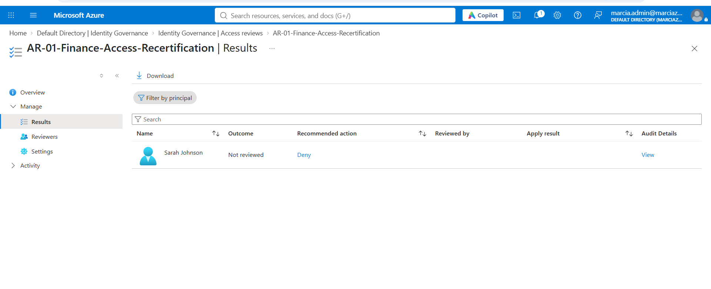

**Configuration demonstrated:** Initial review results for the Finance access recertification.

**Technical explanation:** The review interface identifies the access assignment requiring evaluation and provides the review workflow's current decision status.

**Business relevance:** Administrators need visibility into outstanding reviews before making or applying access decisions.

**Evidence verified:** The screenshot records the review's initial results before the final remediation.

### Evidence 07 — Reviewer Workspace

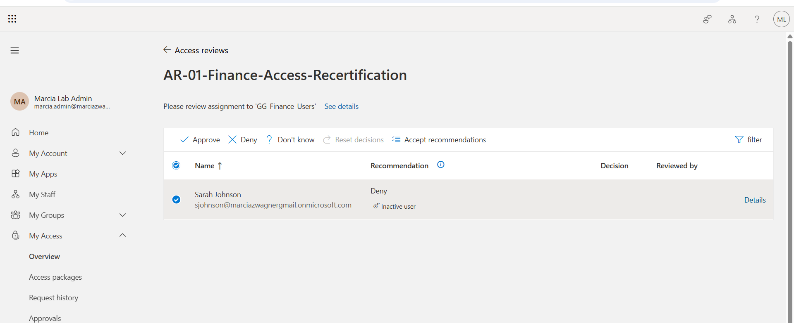

**Configuration demonstrated:** The assigned Finance access review displayed in the Microsoft My Access reviewer interface.

**Technical explanation:** The reviewer workspace provides the interface for evaluating the user's continued access and submitting a decision.

**Business relevance:** A designated review workspace supports structured access recertification and administrative accountability.

**Evidence verified:** The screenshot documents the reviewer interface used for the Finance access review.

### Evidence 08 — Documented Access Denial

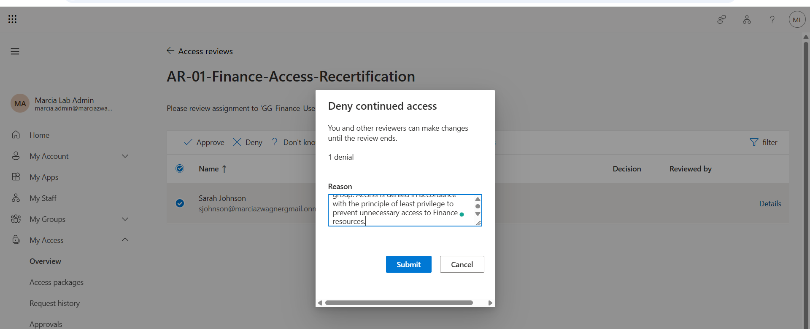

**Decision demonstrated:** Manual denial of Sarah Johnson's continued Finance access.

**Technical explanation:** The simulated business scenario treated Sarah Johnson as having transferred from Finance to Human Resources. Because her Finance group access was no longer required under that scenario, I selected Deny and provided a business justification.

**Business relevance:** Access decisions should reflect current job responsibilities and least-privilege requirements rather than relying solely on automated recommendations.

**Evidence verified:** The screenshot documents the denial action and its supporting justification.

### Evidence 09 — Recorded Review Decision

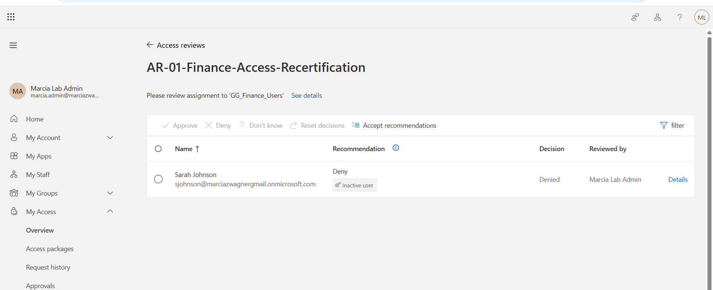

**Configuration demonstrated:** The submitted decision recorded within the Finance access review.

**Technical explanation:** Recording a denial establishes the reviewer's access recertification decision. It does not necessarily remove access until the results are applied.

**Business relevance:** Distinguishing a recorded decision from completed remediation helps prevent inaccurate access-governance reporting.

**Evidence verified:** The screenshot documents the review decision associated with the Finance access assignment.

### Evidence 10 — Review Completion

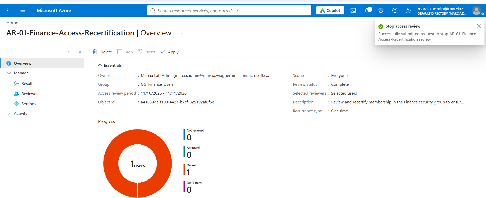

**Configuration demonstrated:** Finance access review completed after the single targeted user was reviewed.

**Technical explanation:** Once the review decision was recorded, the review was stopped and marked complete.

**Business relevance:** Completing the review closes the decision-making phase and prepares the results for subsequent administrative action.

**Evidence verified:** The screenshot documents the completed review status.

### Evidence 11 — Successful Access Remediation

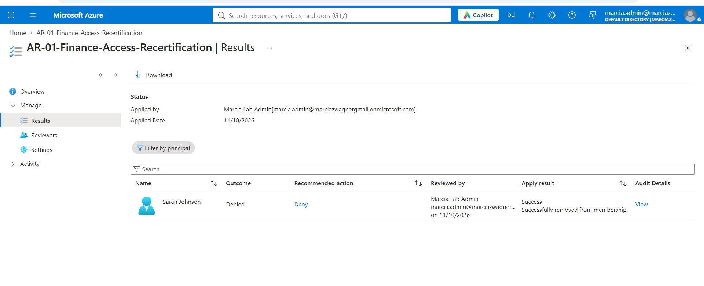

**Action demonstrated:** Manual application of the completed access review results.

**Technical explanation:** Because automatic application was disabled, I separately applied the results. Microsoft Entra ID reported a successful removal from Finance group membership.

**Recorded result:** `Successfully removed from membership`

**Business relevance:** Applying a denied review decision converts an access governance assessment into an actual reduction of unnecessary access.

**Evidence verified:** The screenshot documents successful application of the access review result by Marcia Lab Admin.

### Evidence 12 — Independent Membership Verification

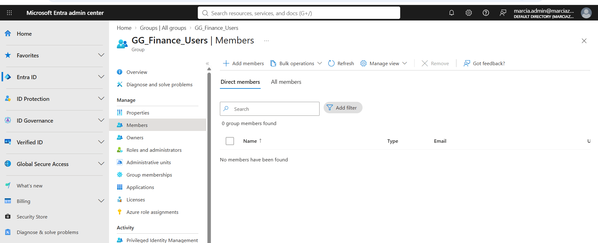

**Verification demonstrated:** Direct membership inspection of the `GG_Finance_Users` security group.

**Technical explanation:** After applying the access review results, I independently inspected the Finance group's direct members rather than relying exclusively on the review's success message.

**Observed result:**

- `0 group members found`
- `No members have been found`

**Business relevance:** Independent verification provides stronger evidence that an access removal was completed.

**Evidence verified:** The screenshot confirms the Finance group had no direct members following remediation. This does not establish the absence of all other possible permissions across the tenant.

### Evidence Summary

These 12 screenshots document the access governance lifecycle from review configuration through decision-making, completion, remediation, and independent verification.

The completed lab demonstrates the distinction between:

1. Identifying access that requires review.
2. Recording a justified access decision.
3. Applying the review results.
4. Confirming that the intended membership change occurred.

**Outcome:** Sarah Johnson's direct Finance group membership was successfully removed in the lab tenant following a documented, manually applied denial decision.

**Scope limitation:** The department transfer was simulated. The verification confirms the Finance group's direct membership status, not every potential access assignment elsewhere in Microsoft Entra ID.

## 12. Skills Demonstrated

- Microsoft Entra Identity Governance
- Access review creation and configuration
- Access recertification
- Security group membership review
- Manual access decision-making
- Least-privilege analysis
- Review justification documentation
- Manual application of review results
- Group membership remediation
- Independent verification of access removal
- Security documentation and audit evidence

## 13. Lessons Learned

This project reinforced that access governance involves more than identifying potentially excessive permissions.

An effective review workflow includes evaluating business need, documenting an access decision, applying the decision, and verifying the actual change.

I also learned why a completed access review does not necessarily mean access has already been removed, especially when automatic application is disabled.

The independent membership verification demonstrated the value of confirming the result directly in the affected resource.

---

**Environment note:** This project was completed in a personal Microsoft Entra ID training environment using simulated employee identities and a fictional business scenario. The access review and group membership removal were performed in the lab tenant, not a production organization.
