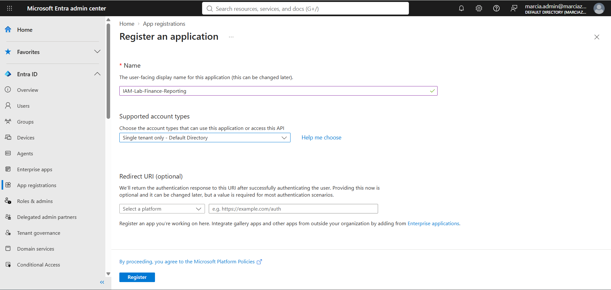
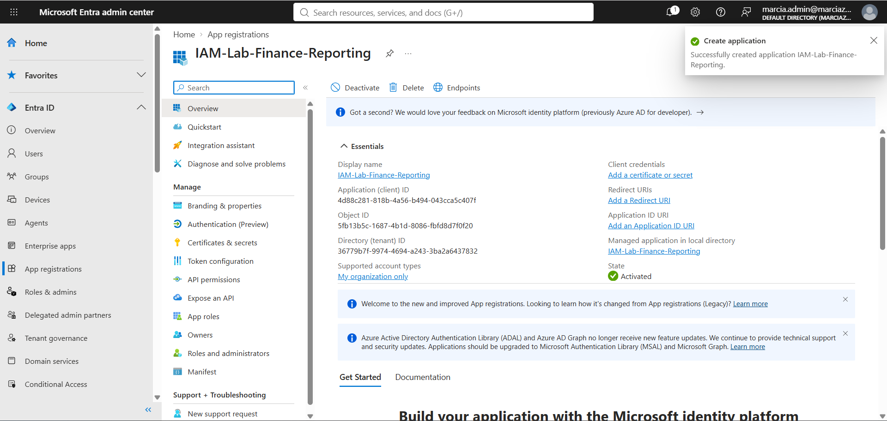
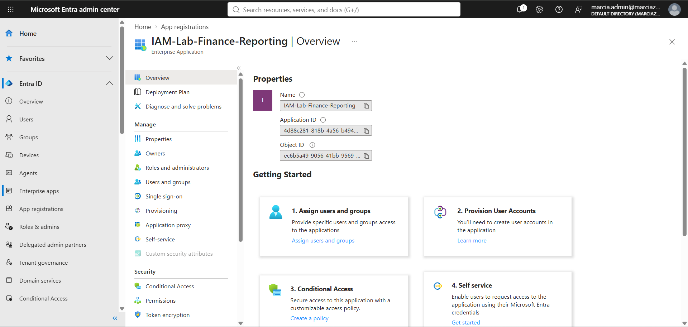
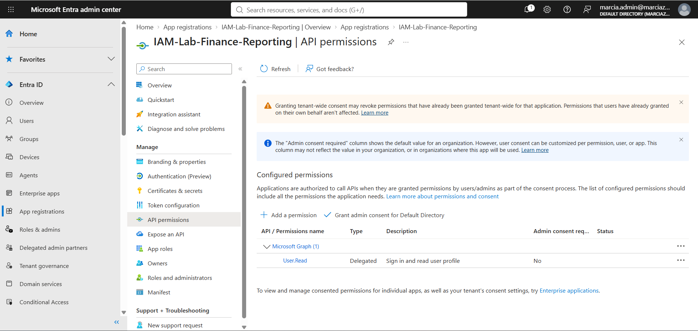
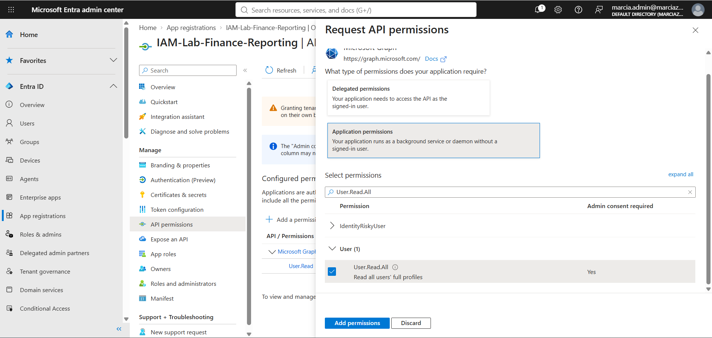
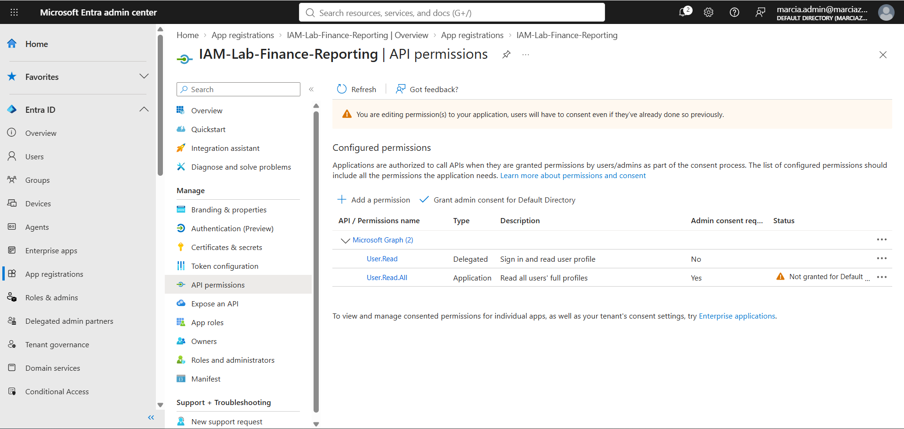
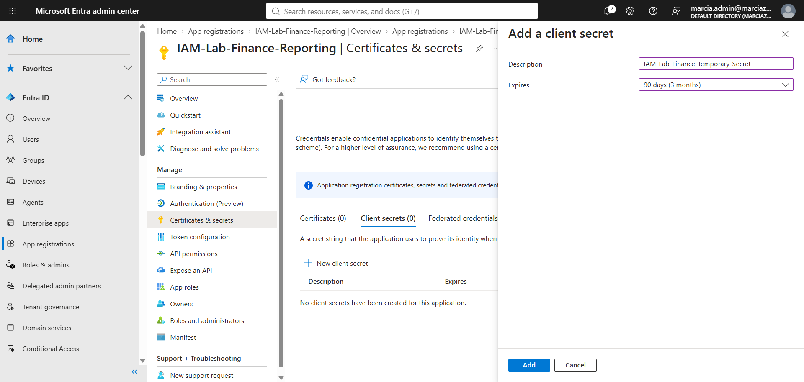
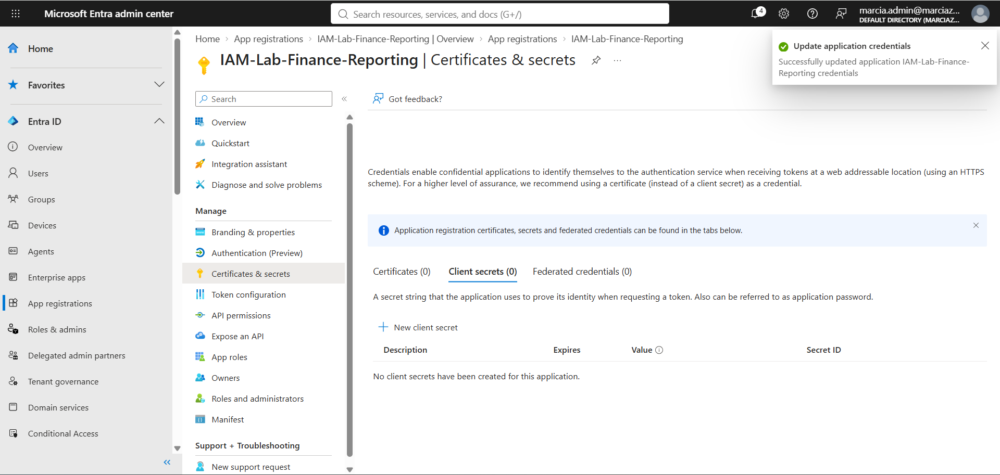
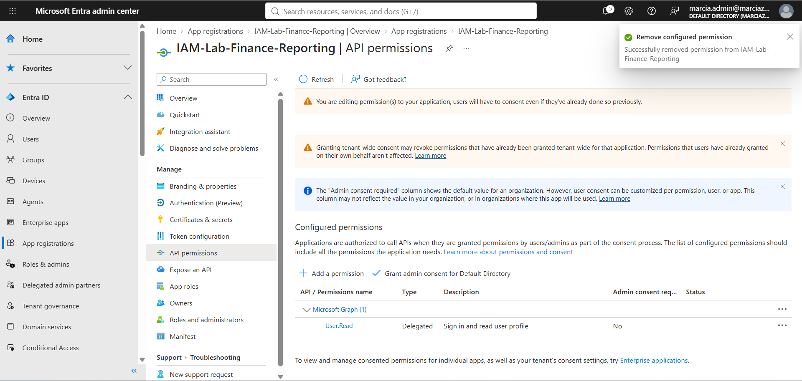

# Lab 04 — Non-Human Identity Management

**Project Status:** Completed  
**Environment:** Microsoft Entra ID — Personal Training Tenant  
**Focus:** Application Registrations, Service Principals, API Permissions, Credential Lifecycle Management, and Least Privilege

---

## 1. Project Overview

This project demonstrates how non-human identities are registered, configured, evaluated, and secured using Microsoft Entra ID.

I registered a single-tenant Finance reporting application, examined its corresponding enterprise application and service principal, assessed Microsoft Graph API permissions, created a temporary application credential, and performed security remediation.

The exercise focused on identifying unnecessary privileges, understanding application credential risks, and validating least-privilege security controls within a personal training environment.

## 2. Business Scenario

A fictional organization uses an internal Finance reporting application to support automated reporting processes.

Unlike a traditional employee account, the application uses its own identity to authenticate to services without requiring an employee to sign in interactively.

**Application:** `IAM-Lab-Finance-Reporting`

**Security concerns:**

- Applications can request access to sensitive directory information.
- Broad application permissions can expose information across an entire tenant if granted.
- Client secrets must be protected and managed throughout their lifecycle.
- Unnecessary credentials and permissions increase security exposure.

**Objective:** Create and assess the application identity, investigate its permissions and credentials, and remove unnecessary access.

This project focused on application identity administration rather than implementing a functioning Finance reporting service.

## 3. Tools and Technologies

- Microsoft Entra ID
- App registrations
- Enterprise applications
- Service principals
- Microsoft Graph API permissions
- Application and delegated permission types
- Certificates & secrets
- Application credential lifecycle management
- Least-privilege security principles

## 4. Application Registration

I registered an application named `IAM-Lab-Finance-Reporting` in Microsoft Entra ID.

**Supported account type:** Accounts in this organizational directory only (single tenant)

**Redirect URI:** Not configured

**Application purpose:** Simulated internal Finance reporting service

The registration established an application identity that could be separately configured and secured.

### Technical Explanation

An application registration defines the application's identity and configuration within Microsoft Entra ID.

Its application (client) ID identifies the application, while the application object represents its registered configuration.

A single-tenant registration limits the application to the organization's directory rather than allowing users from other tenants to sign in.

## 5. Enterprise Application and Service Principal

After creating the registration, I navigated to its managed application in the local directory.

Microsoft Entra ID displayed a corresponding enterprise application and service principal.

### Technical Explanation

The application registration describes the application's configuration.

The service principal represents the application's identity within a tenant and is the object through which tenant-specific access and policy assignments can be managed.

The application object ID and service principal object ID are different because they represent different directory objects.

### Business Relevance

Understanding the distinction helps administrators identify which application identity exists in a tenant and where its access can be managed.

## 6. Microsoft Graph API Permission Assessment

I examined the application's Microsoft Graph API permissions.

The application initially included:

**Permission:** `User.Read`  
**Permission type:** Delegated  
**Purpose:** Sign in and read a user's own profile

I then added the following permission for evaluation:

**Permission:** `User.Read.All`  
**Permission type:** Application  
**Purpose:** Read all users' full profiles

**Administrator consent:** Required

**Consent status:** Not granted

### Security Analysis

Delegated permissions are used when an application acts on behalf of a signed-in user.

Application permissions can allow an application to act without an interactive user, subject to the required authorization and consent.

`User.Read.All` is a broad Microsoft Graph application permission because it permits directory-wide user-profile access when granted.

Although the permission was configured during the exercise, administrator consent was not granted.

**Important distinction:** A configured permission request is not equivalent to an effective, consented permission.

## 7. Temporary Client Secret Assessment

I examined the application's **Certificates & secrets** settings and created a temporary client secret with a 90-day expiration.

**Credential description:** `IAM-Lab-Finance-Temporary-Secret`

**Credential type:** Client secret

**Expiration:** 90 days

### Technical Explanation

A client secret is an application credential used to prove an application's identity during supported authentication flows.

Unlike an application ID, the secret value is sensitive and must not be exposed in public repositories, screenshots, or documentation.

Shorter credential lifetimes help reduce the period during which a compromised secret remains usable.

### Business Relevance

Application credentials require inventory, controlled storage, expiration monitoring, rotation, and timely removal when no longer necessary.

No client secret value is included in this portfolio.

## 8. Security Review and Remediation

After evaluating the application's configuration, I reviewed its requested privileges and temporary credential.

The directory-wide `User.Read.All` application permission was identified as unnecessary for the limited training scenario.

I removed this requested permission before administrator consent was granted.

I also removed the temporary client secret after completing the credential-lifecycle exercise.

### Security Rationale

Removing unnecessary API permission requests reduces the risk of future excessive authorization.

Deleting a temporary credential prevents its continued use after the exercise is complete.

The objective was to leave the application with no unnecessary directory-wide application permission or temporary secret.

## 9. Verification and Results

The final review confirmed:

- The application registration and corresponding service principal were created.
- Microsoft Graph permission types were inspected and evaluated.
- `User.Read.All` was assessed without granting administrator consent.
- The unnecessary application permission was removed.
- A temporary 90-day client secret was created for training.
- The temporary client secret was subsequently removed.

### Validation Limitations

This exercise did not include production deployment, token acquisition, live Microsoft Graph API calls, or access to actual organizational Finance records.

The application was a simulated reporting service used for identity security administration.

The results demonstrate application configuration and remediation rather than end-to-end application functionality.

## 10. Security Analysis and Business Relevance

### Non-Human Identity Security

Applications and service principals must be managed as identities because they can receive privileges and access organizational resources.

### Least Privilege

Permissions should be based on documented application requirements rather than granted simply because they are available.

### Consent Governance

Administrator consent is an important control over high-impact application permissions.

### Credential Lifecycle

Temporary credentials should be protected, periodically reviewed, and removed when no longer necessary.

### Verification

Reviewing application permissions and credential inventory after remediation provides evidence of the resulting security configuration.

## 11. Evidence & Screenshots

The following nine screenshots document my hands-on Microsoft Entra ID non-human identity management exercise.

The project involved creating an application registration, inspecting its service principal, evaluating Microsoft Graph API permissions, managing a temporary application credential, and performing security remediation.

The environment was a personal training tenant using a simulated internal Finance reporting application.

### Evidence 01 — Application Registration Configuration

**Configuration demonstrated:** Creation of the `IAM-Lab-Finance-Reporting` application using the single-tenant organizational directory option.

**Technical explanation:** App registrations establish application identities within Microsoft Entra ID. The single-tenant account setting limits which organizational directory the application is designed to support.

**Business relevance:** Defining the appropriate tenancy model helps organizations control the scope of application identity configurations.

**Evidence verified:** The screenshot documents the application's initial registration settings.

### Evidence 02 — Application Identity Created

**Configuration demonstrated:** The successfully created `IAM-Lab-Finance-Reporting` application registration.

**Technical explanation:** Microsoft Entra ID assigns identifiers to the registered application, including an application (client) ID and application object ID. These identifiers distinguish the application from other directory objects.

**Business relevance:** Accurate application identification supports inventory management, ownership tracking, and security reviews.

**Evidence verified:** The screenshot documents the registered application and its overview information.

### Evidence 03 — Service Principal Inspection

**Configuration demonstrated:** Inspection of the enterprise application associated with `IAM-Lab-Finance-Reporting`.

**Technical explanation:** The application registration defines the application's configuration, while its service principal represents the application within the tenant. The service principal has its own object ID, distinct from the application registration's object ID.

**Business relevance:** Understanding service principals helps identity administrators locate and review application identities and their tenant-specific access.

**Evidence verified:** The screenshot documents the enterprise application and corresponding service principal.

### Evidence 04 — Baseline Microsoft Graph Permissions

**Configuration demonstrated:** Inspection of the application's existing Microsoft Graph permission configuration.

**Technical explanation:** The application initially included `User.Read` as a delegated permission. Delegated permissions allow an application to act within the context of a signed-in user, subject to the applicable authorization.

**Business relevance:** Reviewing baseline API permissions helps administrators understand which access has been requested before making configuration changes.

**Evidence verified:** The screenshot documents the application's initial Microsoft Graph API permission settings.

### Evidence 05 — Application Permission Selection

**Configuration demonstrated:** Selection of the Microsoft Graph `User.Read.All` application permission.

**Technical explanation:** Application permissions are designed for application-only access without an interactive signed-in user. The `User.Read.All` application permission can enable reading full user profiles throughout the directory when appropriately consented.

**Business relevance:** Broad application permissions require careful evaluation because an application identity may have access extending beyond one employee's account.

**Evidence verified:** The screenshot documents the selection of the directory-wide application permission for the security assessment.

### Evidence 06 — Permission Risk Assessment

**Configuration demonstrated:** Review of the application's configured Microsoft Graph permissions and administrator consent status.

**Technical explanation:** The `User.Read.All` application permission requires administrator consent. During this exercise, the permission was configured for evaluation but administrator consent was not granted.

A requested API permission is not equivalent to an effective permission grant.

**Business relevance:** Administrators should identify excessive permission requests before approval to prevent unnecessary exposure of organizational directory information.

**Evidence verified:** The screenshot documents the broad application permission request and its ungranted consent status.

### Evidence 07 — Temporary Application Credential

**Configuration demonstrated:** Creation and inspection of a temporary client secret for `IAM-Lab-Finance-Reporting`.

**Credential description:** `IAM-Lab-Finance-Temporary-Secret`

**Expiration:** 90 days

**Technical explanation:** Client secrets are credentials that applications can use to authenticate during supported application authentication flows. A secret value must be treated as sensitive authentication material.

Using a shorter expiration period reduces the potential lifetime of a compromised credential.

**Business relevance:** Organizations should maintain application credential inventories, enforce appropriate expiration periods, and rotate or remove credentials when necessary.

**Evidence verified:** The screenshot documents the temporary credential configuration and its lifecycle settings.

**Security note:** No client secret value is included in this documentation.

### Evidence 08 — Credential Security Remediation

**Action demonstrated:** Removal of the temporary client secret after completing the credential management exercise.

**Technical explanation:** Deleting an unnecessary application credential prevents that credential from continuing to authenticate the application.

The credential was created for training rather than to support an operational reporting service.

**Business relevance:** Removing credentials that are no longer required reduces application identity exposure and supports credential lifecycle management.

**Evidence verified:** The screenshot documents the credential remediation state following the training exercise.

### Evidence 09 — Permission Remediation and Verification

**Action demonstrated:** Removal of the unnecessary `User.Read.All` application permission request.

**Technical explanation:** The directory-wide permission was assessed as excessive for the limited training scenario and removed without granting administrator consent.

Removing an ungranted permission request prevents that request from remaining in the application's configured permissions. It should not be described as revoking an already granted permission.

**Business relevance:** Reviewing and reducing unnecessary permission requests supports least-privilege application administration and safer consent governance.

**Evidence verified:** The screenshot documents the updated Microsoft Graph API permission configuration following remediation.

### Evidence Summary

These nine screenshots document the non-human identity management lifecycle from application registration through security review and remediation.

The exercise demonstrates:

1. Registering an application identity in Microsoft Entra ID.
2. Identifying its corresponding service principal.
3. Distinguishing delegated permissions from application permissions.
4. Evaluating broad Microsoft Graph permission requests and administrator consent.
5. Creating and reviewing a temporary application credential.
6. Removing unnecessary credentials and permission requests.
7. Verifying the resulting application security configuration.

**Outcome:** The simulated Finance reporting application was registered and evaluated, and unnecessary application permissions and temporary credentials were removed.

**Validation limitation:** This project did not involve a deployed Finance reporting service, successful application token acquisition, live Microsoft Graph API calls, or access to production organizational information.

The evidence documents identity administration and security configuration within a personal Microsoft Entra training environment.

## 12. Skills Demonstrated

- Microsoft Entra application registration
- Single-tenant application configuration
- Enterprise application administration
- Service principal identification
- Microsoft Graph API permission assessment
- Delegated versus application permission analysis
- Administrator consent awareness
- Least-privilege assessment
- Client secret creation and expiration management
- Application credential security
- Permission remediation
- Credential removal and lifecycle management
- Technical documentation and verification

## 13. Lessons Learned

This project reinforced that non-human identities require security oversight comparable to employee identities.

Application registrations, service principals, API permissions, and credentials serve different purposes and must be evaluated individually.

I learned the importance of distinguishing requested permissions from administrator-consented permissions and of removing credentials that are no longer required.

The exercise also demonstrated how reviewing and reducing application privileges can support a least-privilege security model.

---

**Environment note:** This project was completed in a personal Microsoft Entra ID training environment using a simulated internal Finance application. No production applications or organizational data were involved.
