# Lab 05 — Advanced Active Directory: Delegation, Group Policy & Security Review

**Project status:** Configuration and administrative review completed; delegated-user functional testing and client-side GPO application not verified.  
**Lab date:** November 25, 2026  
**Environment:** Windows Server domain controller `IAM-DC01` in Hyper-V; Active Directory domain `corp.marcia.test`; isolated `IAM-LAB` private virtual switch.  
**Focus:** Role-based group management, scoped password-reset delegation, Group Policy configuration, least-privilege review, and evidence-based verification.

---

## 1. Project Overview

In this hands-on Microsoft Active Directory lab, I configured a role-based IT Helpdesk security group, delegated narrowly scoped password-management rights over Finance user objects, created a department-linked user security GPO, and audited the resulting group memberships and policy configuration. All work took place in a personal training domain with fictional employee accounts.

The lab distinguishes **configuration verification** (ACLs and GPO settings visibly saved) from **functional enforcement testing** (whether a standard user can execute a reset, or whether a client receives the GPO). The former was demonstrated; the latter was not completed.

## 2. Business Scenario

A fictional organization maintains departmental user accounts in Finance, Human Resources, IT, Operations, and Sales. An IT Helpdesk employee, Michael Brown, needs password-reset capabilities for Finance accounts, but should not be made a Domain Administrator. Separately, the IT department requires baseline user-session protection settings.

## 3. Environment and Scope

| Component | Lab configuration |
|---|---|
| Directory | `corp.marcia.test` |
| Server | `IAM-DC01`, Windows Server running in Hyper-V |
| Organizational units | `Employees/Finance`, `Employees/Human Resources`, `Employees/IT`, `Employees/Operations`, `Employees/Sales` |
| Delegated security principal | `GG_IT_Helpdesk` (global security group in IT OU) |
| Delegated rights target | `Employees/Finance` and descendant user objects |
| Group member | Michael Brown (fictional IT account) |
| Finance test identity | Sarah Johnson (fictional lab account) |
| GPO | `GPO-IT-Workstation-Security`, linked at `Employees/IT` |
| Virtual network | `IAM-LAB` private Hyper-V switch |

## 4. Implementation and Results

### 4.1 Role-based group management

Created `GG_IT_Helpdesk` as a global security group inside the IT OU and added Michael Brown. Verified membership from both the group object and Michael’s Member Of tab. This is a role-based group assignment, **not** a grant of domain-wide administration.

### 4.2 Scoped administrative delegation

Used the Delegation of Control Wizard for the **Finance OU** and selected `GG_IT_Helpdesk` as the delegate. Configured the common password reset / require-change-at-next-logon task, then inspected Finance OU advanced security settings. The saved access-control entries showed **Reset password** on descendant user objects and separate **Read/Write `pwdLastSet`** permissions. These grants are scoped to Finance descendants rather than all Employees OUs.

### 4.3 Group Policy management

Created and linked `GPO-IT-Workstation-Security` to the IT OU without editing the Default Domain Policy or Default Domain Controllers Policy. Configured these **User Configuration** settings under **Policies → Administrative Templates → Control Panel → Personalization**:

| Configured policy | Saved value |
|---|---|
| Enable screen saver | Enabled |
| Password protect the screen saver | Enabled |
| Screen saver timeout | Enabled — 900 seconds (15 minutes) |

Reviewed the saved GPO Settings report and Scope tab. The IT OU link was enabled, not enforced; Security Filtering was `Authenticated Users`, and no WMI filter was attached. Although named “Workstation Security,” this GPO contains **user** policies and is linked to the IT **user** OU. Nothing in the lab establishes that a workstation actually processed the settings.

### 4.4 Security audit and testing boundaries

Verified Michael’s direct membership in `Domain Users` and `GG_IT_Helpdesk`, with no direct Domain Admins membership listed. The attempt to start Active Directory Users and Computers under Michael’s credentials **on the domain controller** was blocked by Windows with a requested-logon-type restriction. The isolated private Hyper-V network did not provide host-to-guest connectivity and no domain-joined client workstation VM existed. I therefore **did not claim a successful delegated reset test** or successful client-side GPO application. I also did not weaken domain controller sign-in restrictions to bypass the issue.

## 5. Evidence & Screenshots

All images below are original PNG screenshots retained in this folder. Select an image to open its original version in GitHub. Each evidence item records exactly what the screenshot supports.

### Evidence 01 — Existing Active Directory Organizational Structure

[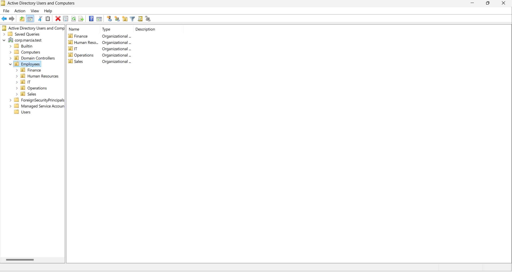](./01-Existing-Departmental-OUs.png)

**Configuration demonstrated:** ADUC displayed the existing `corp.marcia.test` domain and departmental organizational units, including the `Employees` hierarchy.  
**Technical explanation:** Organizational units provide administrative boundaries and a place to scope delegated permissions and GPO links.  
**Business relevance:** Departmental separation supports structured identity management and targeted policy administration.  
**Evidence verified:** The existing OU structure was visible; the screenshot does not itself establish any delegation or GPO enforcement.

---

### Evidence 02 — IT Organizational Unit and Test Identity

[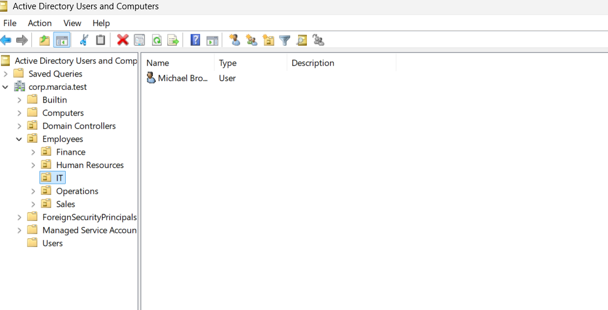](./02-IT-OU-Michael-Brown.png)

**Configuration demonstrated:** The IT OU contained the lab account Michael Brown.  
**Technical explanation:** The directory user serves as a non-admin test identity for group membership and delegated permissions.  
**Business relevance:** Helpdesk operations should be assigned to named test identities through security groups rather than broad domain administrator privileges.  
**Evidence verified:** Michael Brown was visible in the IT OU.

---

### Evidence 03 — Baseline Group Membership

[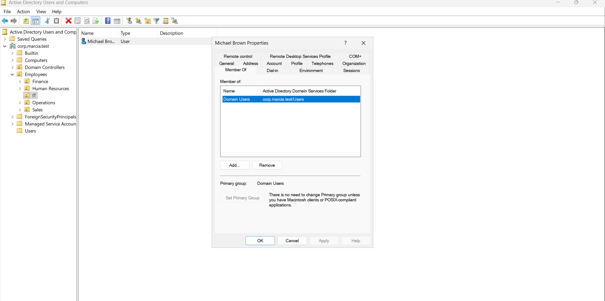](./03-Michael-Brown-Baseline-Membership.png)

**Configuration demonstrated:** Michael Brown’s Member Of tab initially listed `Domain Users`.  
**Technical explanation:** A baseline membership review establishes the starting state before access changes.  
**Business relevance:** Before-and-after evidence supports access auditability and least-privilege review.  
**Evidence verified:** The captured baseline listed `Domain Users`; this is not evidence of all effective permissions.

---

### Evidence 04 — IT Helpdesk Security Group Configuration

[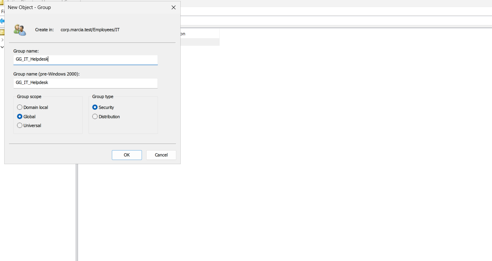](./04-Helpdesk-Group-Configuration.png)

**Configuration demonstrated:** The New Object - Group dialog showed `GG_IT_Helpdesk` being created inside `Employees/IT`, using **Global** scope and **Security** type.  
**Technical explanation:** A global security group can represent a job function and receive delegated rights independently of individual accounts.  
**Business relevance:** Group-based authorization simplifies onboarding and removing staff from a Helpdesk role.  
**Evidence verified:** The configuration screen documented the intended group attributes before creation.

---

### Evidence 05 — Helpdesk Group Membership Confirmed

[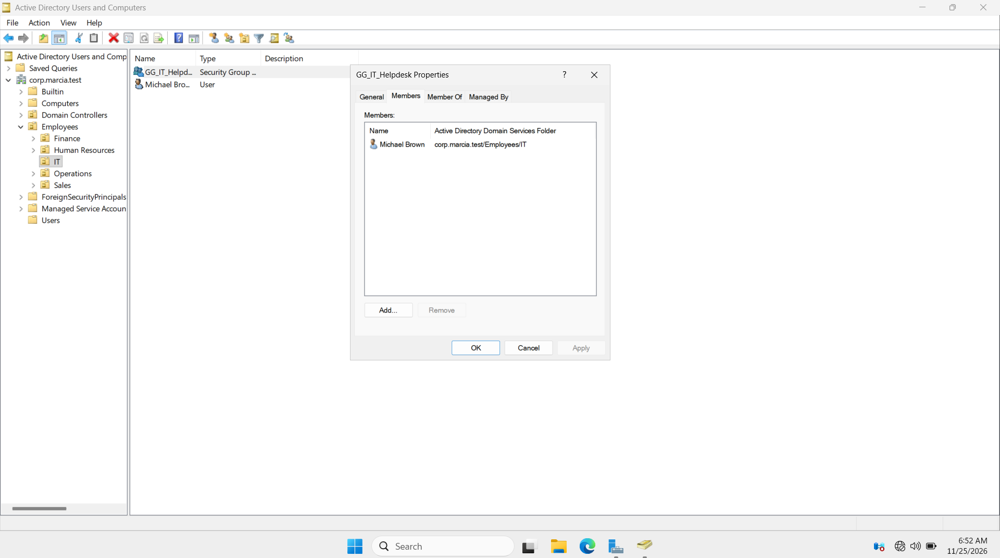](./05-Helpdesk-Group-Michael-Membership.png)

**Configuration demonstrated:** The `GG_IT_Helpdesk` Members tab listed Michael Brown.  
**Technical explanation:** Adding the account to the Helpdesk group creates an auditable role-to-user assignment.  
**Business relevance:** Role-based group membership avoids directly granting broad permissions to a named user.  
**Evidence verified:** The screenshot verified Michael Brown as a direct member of `GG_IT_Helpdesk`.

---

### Evidence 06 — Finance OU Delegation Scope

[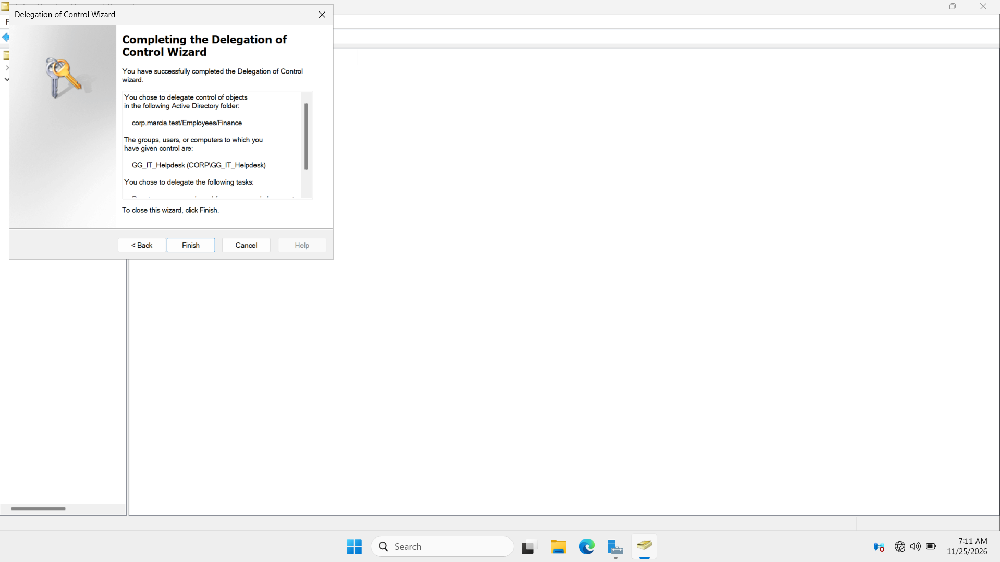](./06-Delegation-Wizard-Finance-Scope.png)

**Configuration demonstrated:** The Delegation of Control Wizard summary identified `corp.marcia.test/Employees/Finance` and the principal `GG_IT_Helpdesk`.  
**Technical explanation:** Delegation uses an OU scope and a selected security principal to define where permissions are assigned.  
**Business relevance:** Finance-scoped delegation is narrower than delegating the same rights across the entire Employees hierarchy.  
**Evidence verified:** The summary confirmed the selected Finance scope and Helpdesk principal. The full task list was not visible in this screenshot.

---

### Evidence 07 — Delegation Access Control Entries

[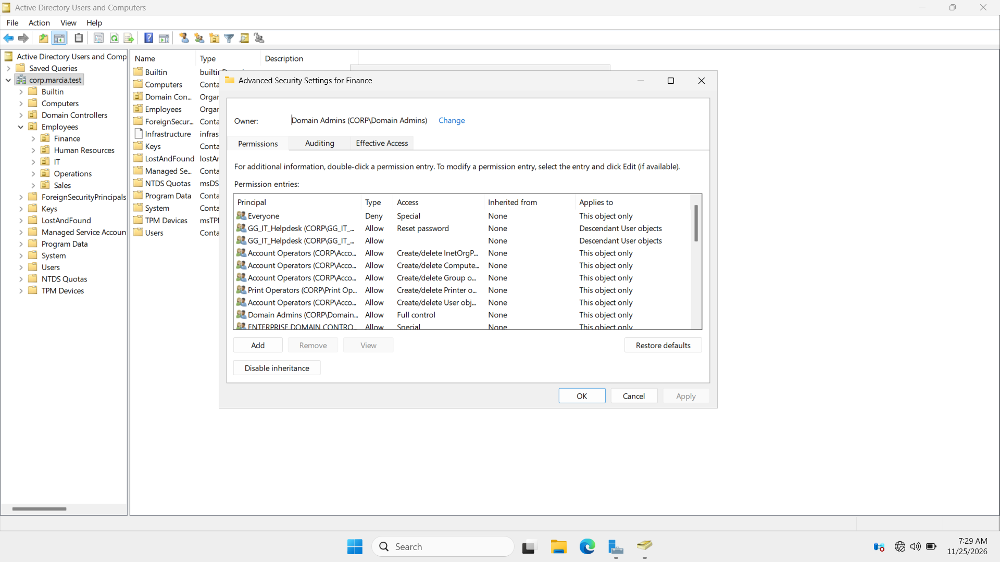](./07-Finance-Explicit-Delegation-Entries.png)

**Configuration demonstrated:** Advanced Security Settings for Finance showed `GG_IT_Helpdesk` with explicit Allow entries, including **Reset password**, applying to **Descendant User objects**.  
**Technical explanation:** The ACL entries are the saved authorization configuration on the Finance OU; this goes beyond completion of the wizard.  
**Business relevance:** Delegating targeted rights supports a Helpdesk password-reset workflow without adding the group to Domain Admins.  
**Evidence verified:** The Reset password entry was visible as an explicit descendant-user permission. The second Helpdesk entry was inspected separately.

---

### Evidence 08 — Password-Change Attribute Permissions

[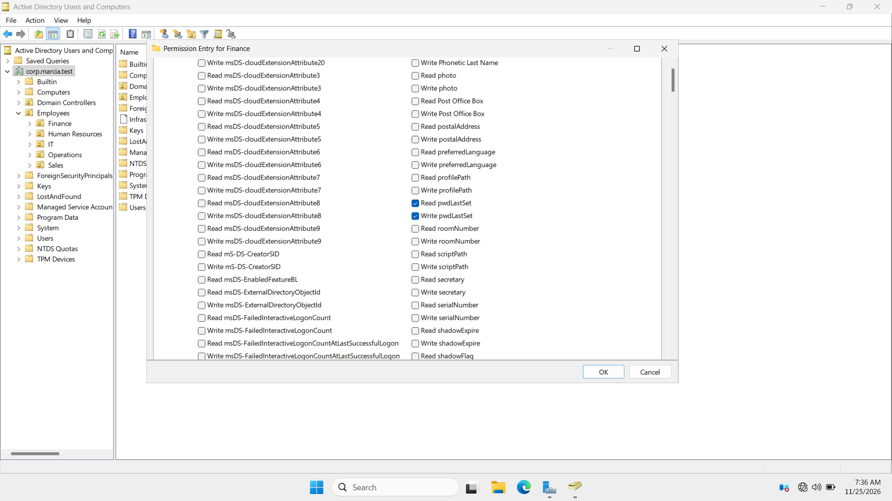](./08-Finance-pwdLastSet-Permissions.png)

**Configuration demonstrated:** The other Helpdesk permission entry showed `Read pwdLastSet` and `Write pwdLastSet` checked.  
**Technical explanation:** The `pwdLastSet` attribute is involved in whether users must change their password at the next logon; its scoped read/write rights complement the reset-password control.  
**Business relevance:** Explicit attribute permissions help restrict a support role to necessary password-management functions.  
**Evidence verified:** The checked `pwdLastSet` rights were visible. The screen does not prove a delegated reset was performed.

---

### Evidence 09 — Finance Test-Account Inventory

[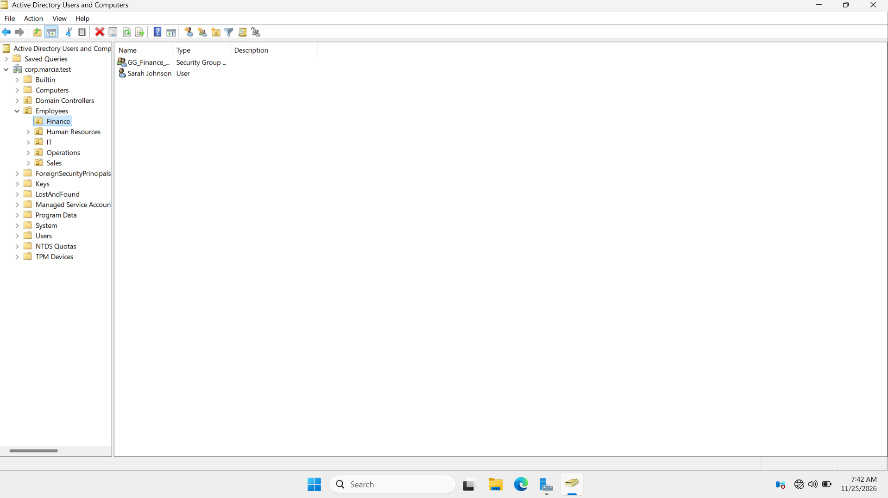](./09-Finance-Test-Account-Baseline.png)

**Configuration demonstrated:** The Finance OU displayed the Sarah Johnson lab user and the `GG_Finance_Users` security group.  
**Technical explanation:** A test subject must reside in the OU where delegation is configured.  
**Business relevance:** Selecting an existing fictional lab user avoids altering production accounts.  
**Evidence verified:** Sarah Johnson was present in the Finance OU; no delegated password reset was demonstrated by this inventory image.

---

### Evidence 10 — New IT GPO and Link

[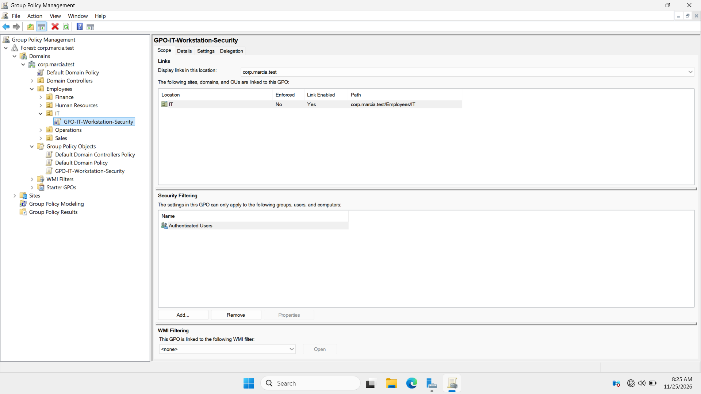](./10-GPO-IT-OU-Link-and-Scope.png)

**Configuration demonstrated:** The `GPO-IT-Workstation-Security` GPO appeared in Group Policy Objects and was linked to `Employees/IT`; the link was enabled, not enforced.  
**Technical explanation:** A GPO is created as a separate policy object and linked to an OU to determine its processing scope.  
**Business relevance:** Separating departmental policies avoids making unnecessary changes to the Default Domain Policy.  
**Evidence verified:** The IT OU link and its enabled status were visible. No workstation application was proven.

---

### Evidence 11 — Screen Saver Password Protection

[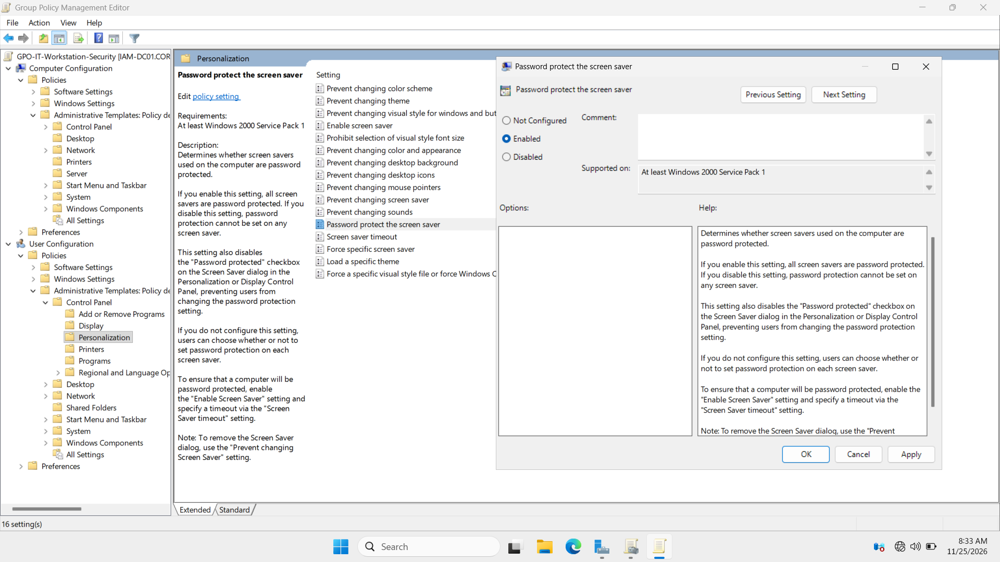](./11-Screen-Saver-Password-Policy.png)

**Configuration demonstrated:** The User Configuration policy dialog showed **Password protect the screen saver** selected as Enabled.  
**Technical explanation:** This user-based administrative template directs client behavior when a screen saver runs.  
**Business relevance:** Password-protected screen savers reduce the risk of unauthorized access to an unattended logged-in session.  
**Evidence verified:** Enabled was selected in the configuration dialog; later GPO reporting independently confirmed the saved state.

---

### Evidence 12 — 15-Minute Inactivity Timeout

[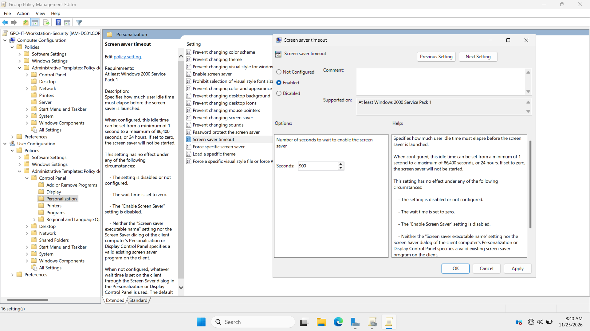](./12-Screen-Saver-Timeout-900.png)

**Configuration demonstrated:** The Screen saver timeout policy dialog showed Enabled with `900` seconds.  
**Technical explanation:** The configured user policy specifies 900 seconds, or 15 minutes, of idle time before the screen saver starts when prerequisites are met.  
**Business relevance:** An inactivity timeout is a session-protection control, particularly for shared or workplace systems.  
**Evidence verified:** The intended value was entered; the later settings report confirmed it was saved.

---

### Evidence 13 — Saved GPO Security Controls Verified

[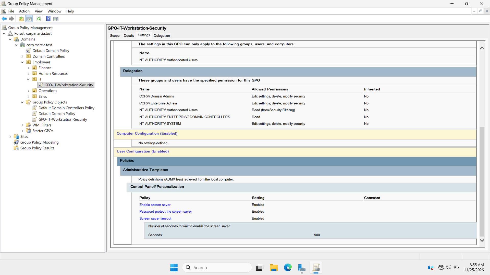](./13-GPO-Final-Security-Settings.png)

**Configuration demonstrated:** The Group Policy Settings report listed three User Configuration policies: **Enable screen saver — Enabled**, **Password protect the screen saver — Enabled**, and **Screen saver timeout — Enabled, 900 seconds**.  
**Technical explanation:** A generated GPO report provides an administrative review of saved policy settings, separate from editing dialogs.  
**Business relevance:** Documenting configured baseline controls aids policy review and audit evidence.  
**Evidence verified:** All three saved settings appeared together. This does not establish that a client processed the GPO.

---

### Evidence 14 — Final GPO Scope and Filtering

[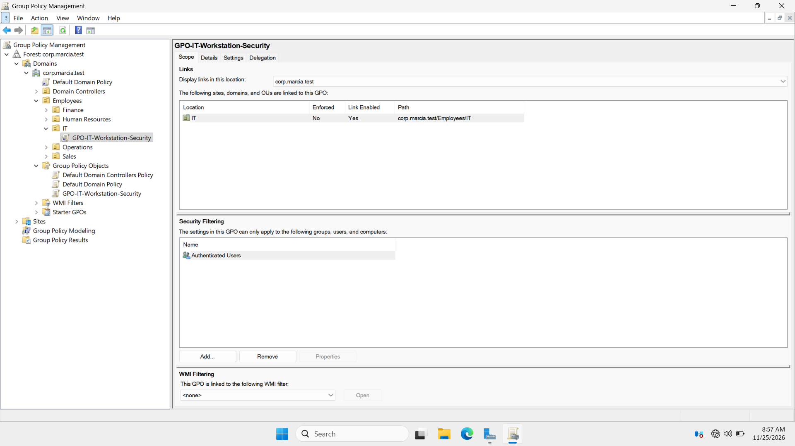](./14-GPO-Final-Scope-Audit.png)

**Configuration demonstrated:** The GPO Scope tab showed its link to `Employees/IT`, Link Enabled Yes, Enforced No, Security Filtering Authenticated Users, and WMI filtering None.  
**Technical explanation:** OU links, security filtering, and WMI filtering jointly influence which accounts can receive policy; `Authenticated Users` does not mean every account in the entire domain receives this OU-linked policy.  
**Business relevance:** Reviewing deployment scope helps avoid unintentionally applying settings across departments.  
**Evidence verified:** The GPO was linked only at the displayed IT OU scope. Its runtime application remained untested.

---

### Evidence 15 — Final Helpdesk Membership Audit

[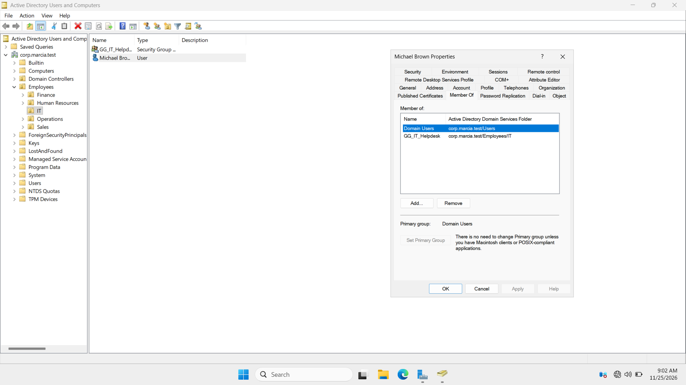](./15-Michael-Brown-Final-Membership-Audit.png)

**Configuration demonstrated:** Michael Brown’s final Member Of tab showed `Domain Users` and `GG_IT_Helpdesk`.  
**Technical explanation:** Final direct-group membership was checked independently of the group’s Members tab.  
**Business relevance:** Membership review helps detect accidental broad privileged role assignments.  
**Evidence verified:** No direct Domain Admins membership was listed. Nested/effective privileges and a successful Michael-initiated reset were not tested.

---

## 6. Skills Demonstrated

- Windows Server Active Directory administration and OU analysis
- Global security groups and role-based access assignment
- Member Of and group membership audits
- Delegation of Control Wizard and OU-scoped ACL examination
- Reset Password extended right and `pwdLastSet` attribute permissions
- Group Policy Object creation, OU linking, and user policy configuration
- Group Policy Settings reports, link status and security filtering review
- Least-privilege reasoning and separation of configuration from functional validation
- Structured audit evidence and technical documentation

## 7. Lessons Learned

The most important distinction in this lab is that **assigning permissions is not the same as verifying them through a real end-user action**. ACL and GPO reports confirm saved configurations; a delegated password-reset operation performed by the assigned Helpdesk user and a client-side Resultant Set of Policy check would be required to establish actual execution and application. A domain controller’s restrictions should not be loosened merely to make a standard-user test convenient.

## 8. Environment and Evidence Notes

This project used only fictional identities in an isolated personal training domain. Passwords are not included in the screenshots or documentation. **No production environment was involved.** Screenshots reflect observed state at capture time; they do not establish all possible effective permissions, nested group memberships, or client-side policy processing.
