# Lab 06 — Privileged Identity Management (PIM)

**Microsoft Entra ID | Eligible role assignments | Just-in-time access | Policy hardening | Audit & verification**

**Project status:** Hands-on configuration, role activation, audit review, and deactivation **completed** on **November 27, 2026**.  
**Training environment:** Isolated Microsoft Entra lab tenant with fictional test identities.  
**Role evaluated:** Reports Reader (read access to sign-in and audit reporting).  
**Administrative identity:** Marcia Lab Admin. **End-user test identity:** Jessica Davis.  
**Evidence:** 18 individually explained, original interface screenshots (cropped to conceal browser tabs, URL bar, and unrelated pages). Select an image to open it at full size on GitHub.

## 1. Executive Summary

This project demonstrates an end-to-end **Privileged Identity Management (PIM) lifecycle** using an appropriately scoped Microsoft Entra Reports Reader role. I established the initial policy and assignment baseline; reduced the maximum activation duration from eight to two hours; required Azure MFA and a written activation reason; assigned a fictional user **time-limited eligibility rather than permanent active privileges**; confirmed she could request and complete activation; examined the administrative and role activation audit trail; then deactivated the role and independently verified that active access was removed while eligibility remained available until its expiration date.

The exercise differentiates **eligible access** (permission to request activation) from **active access** (temporary role privileges). It also distinguishes a **saved MFA policy requirement** from proof that a separate MFA prompt appeared. Jessica enrolled Microsoft Authenticator during sign-in; an additional distinct MFA challenge was **not observed during PIM activation**, so this project does not claim one.

## 2. Security Objectives & Business Context

**Scenario:** A fictional organization wants to minimize standing administrative permissions and ensure role activations are limited, attributable, and reviewable. An IAM analyst must support authorized reporting work without granting long-lived active access.

- Reduce exposure from prolonged elevated access using a shorter maximum activation duration.
- Require an activation justification that can be evaluated later in an audit.
- Apply an MFA requirement at the role activation policy level.
- Issue eligible role assignments with defined beginning and end dates.
- Verify the role lifecycle independently through the end-user view, administrator audit, and active/eligible state checks.
- Revoke active privileges after the test without unintentionally deleting the eligible assignment.

**Scope and least-privilege note:** Reports Reader is a comparatively narrow read-oriented directory role, selected instead of a broadly privileged administrator role. It still gives access to potentially sensitive report information and was used only within a fictional training tenant.

## 3. Environment, Roles, and Security Baseline

| Area | Implementation / observed state |
|---|---|
| Platform | Microsoft Entra admin center → ID Governance → Privileged Identity Management |
| PIM resource | Microsoft Entra roles, Default Directory |
| Role | Reports Reader |
| Admin for assignment and policy | Marcia Lab Admin |
| Eligible test member | Jessica Davis |
| Original max activation window | 8 hours |
| Updated max activation window | 2 hours |
| Activation MFA | Changed from None to Azure MFA |
| Activation justification | Required before and after update |
| Activation approval | Not required; no approver was configured |
| Ticket information | Not required |
| Eligibility window | November 27 to December 4, 2026, seven days |
| Test activation | November 27, 2026; expired at 4:46:09 PM per active-role page |
| Final privileged state | Active role removed; eligible assignment retained |

**Limitations:** The policy used an Entra MFA setting, not a custom Conditional Access authentication context; an activation-specific MFA challenge was not separately observed. Ticket enforcement and approval flow were reviewed but **not configured or tested**. This exercise does not establish effective privileges outside the documented PIM views or show that Jessica accessed specific reporting data.

## 4. Procedure and Verified Outcomes

### Task 01 — Role inventory and baseline assessment

1. Opened PIM and navigated to **Microsoft Entra roles**.
2. Inspected the Reports Reader role and confirmed its eligible-assignment list was initially empty.
3. Reviewed the role’s baseline activation, assignment, and notification settings, including the eight-hour activation maximum and unrestricted permanent eligibility allowance.

**Outcome:** Identified the baseline state and the controls that could be strengthened for a just-in-time access scenario.

### Task 02 — Activation policy hardening

1. Opened **Reports Reader → Role settings → Edit**.
2. Reduced the activation maximum from **8 hours to 2 hours**.
3. Changed **On activation, require** from None to **Azure MFA**, retained **Require justification on activation**.
4. Left ticket information and approval requirements unchanged; submitted **Update**.
5. Observed the success notification and reopened role settings to independently confirm the stored values.

**Outcome:** Saved and verified a shorter, MFA-gated activation policy with required justification. This demonstrates policy configuration, **not** a captured activation-specific MFA verification challenge.

### Task 03 — Seven-day eligible assignment

1. Opened **Reports Reader → Assignments → Add assignments**, selected a fictional non-administrator test user, Jessica Davis.
2. Chose **Eligible**, not Active, to avoid granting standing Reports Reader access.
3. Cleared **Permanently eligible** and configured an eligibility period from **November 27 to December 4, 2026**.
4. Submitted the assignment, observed the successful operation notification, refreshed the list, and verified Jessica appeared under Eligible assignments.

**Outcome:** Successfully created and read back a **direct, time-limited eligible** role assignment.

### Task 04 — End-user just-in-time activation

1. Signed in as Jessica in a separate private browser session; completed Microsoft Authenticator registration requested during sign-in.
2. Opened **PIM → My roles → Microsoft Entra roles** and located Reports Reader under **Eligible assignments**.
3. Opened **Activate**, observed the two-hour limit and mandatory reason field, and submitted a justification describing an IAM training audit of Entra sign-in/audit reports.
4. Observed all three activation completion stages and independently confirmed **Activated** under **Active assignments** with a scheduled end time.

**Outcome:** Verified the eligible-to-active transition and its two-hour expiry in the role activation workflow. A *new separate* activation-time MFA challenge was not documented.

### Task 05 — Audit, deactivation, and least-privilege verification

1. Inspected the administrator’s audit history for the policy update and eligible assignment.
2. Opened **Default Directory → Resource audit**, identifying Jessica’s **Add member to role requested** and **Add member to role completed** entries (approximately **2:46 PM**, November 27, 2026).
3. Returned to Jessica’s Active assignments view and selected **Deactivate** before the scheduled expiration.
4. Observed successful deactivation and refreshed the user’s active-role list, confirming **No results**.
5. Opened **Eligible assignments** and confirmed the underlying Reports Reader eligibility remained intact through December 4.

**Outcome:** Independently verified activation, auditability, successful early deactivation, and preservation of underlying eligibility without standing role access.

## 5. Evidence Gallery — Original Screenshots and Individual Technical Explanations

The evidence descriptions below separate the screen’s observable facts from the security significance and the limits of what it proves. All images were captured from the lab session and cropped only to exclude browser tabs, the address bar, and the Windows taskbar. Images are not synthetic reproductions.

### Evidence 01 — PIM Role Inventory Baseline

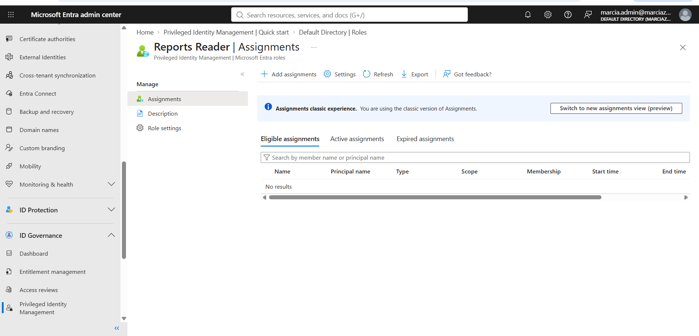

- **Configuration / action demonstrated:** The Reports Reader role was selected in PIM. The eligible assignment list initially had no members.
- **Technical explanation and business relevance:** Establishes a before-state against which later assignment and activation can be compared.
- **Evidence verified / limitation:** The page demonstrates visibility of the role inventory and assignment management controls, not proof of licensing entitlement or successful assignment.

### Evidence 02 — Original Activation Policy

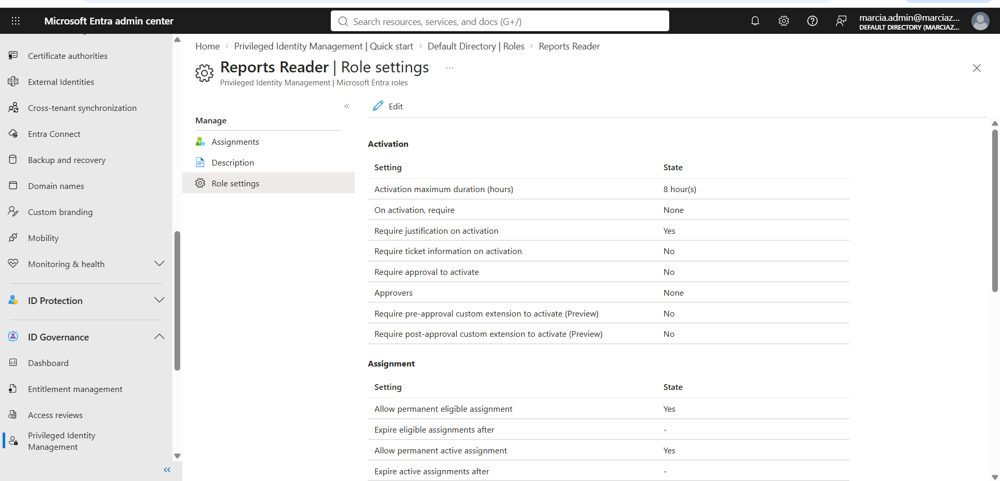

- **Configuration / action demonstrated:** Reviewed the initial Reports Reader activation policy: 8-hour maximum, activation justification required, no additional on-activation control, approval not required.
- **Technical explanation and business relevance:** A baseline is essential before hardening access controls and explaining the purpose of changes.
- **Evidence verified / limitation:** The screenshot establishes configuration at capture time; it does not demonstrate that a user has actually activated the role.

### Evidence 03 — Original Assignment and Notification Policy

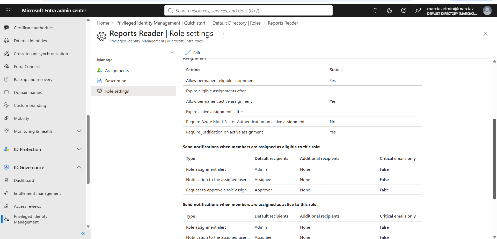

- **Configuration / action demonstrated:** Reviewed assignment settings allowing permanent eligible and active assignments and showing the standard assignment notification recipient structure.
- **Technical explanation and business relevance:** Permitting permanent eligibility or activity requires risk-aware administration; notifications support administrator visibility into role assignment changes.
- **Evidence verified / limitation:** This screenshot documents the available baseline policy, not an exercised approval workflow or evidence of delivered emails.

### Evidence 04 — Proposed Activation Hardening

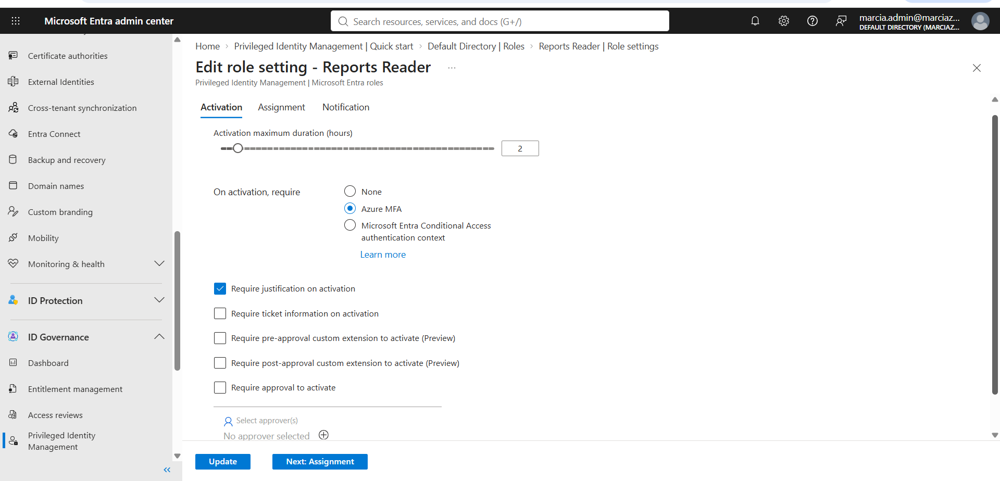

- **Configuration / action demonstrated:** Selected a 2-hour activation maximum, Azure MFA on activation, and mandatory justification; approval and ticket requirements remained unchecked.
- **Technical explanation and business relevance:** A shorter access window reduces the period of elevated permissions, while MFA and documented reasons strengthen control over access requests.
- **Evidence verified / limitation:** Settings shown in an edit form are proposed values until successfully saved and independently checked.

### Evidence 05 — Role Policy Update Success

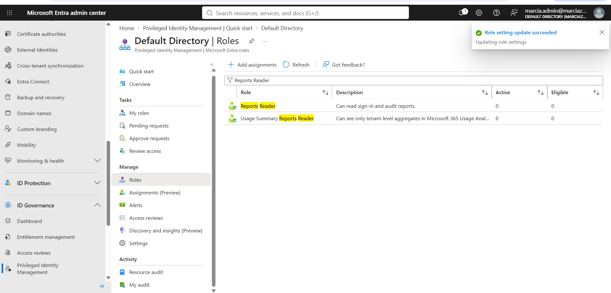

- **Configuration / action demonstrated:** Microsoft Entra displayed the role-setting update success notification after submitting the new Reports Reader configuration.
- **Technical explanation and business relevance:** Captures the completion status of the policy change before subsequent read-back verification.
- **Evidence verified / limitation:** The success message alone does not enumerate every persisted value; Evidence 06 provides that verification.

### Evidence 06 — Saved Activation Policy Verification

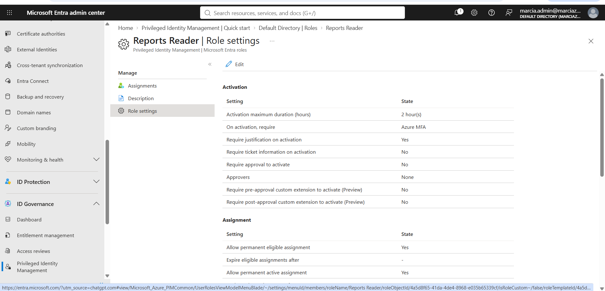

- **Configuration / action demonstrated:** Reopened role settings and verified a 2-hour activation maximum, Azure MFA, and required justification.
- **Technical explanation and business relevance:** Verifying saved settings guards against reporting intended changes as though they were successfully deployed.
- **Evidence verified / limitation:** Confirms policy configuration but not a separately observed MFA challenge during activation.

### Evidence 07 — Time-Limited Eligible Assignment Configured

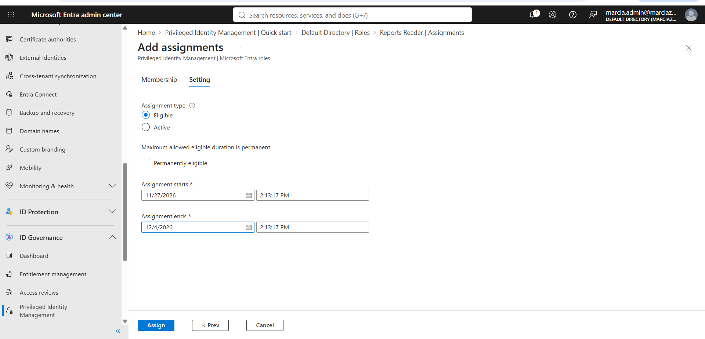

- **Configuration / action demonstrated:** Set the Reports Reader assignment to Eligible, unchecked Permanently eligible, and selected a November 27–December 4, 2026 window for the Jessica Davis test identity.
- **Technical explanation and business relevance:** Time-limited eligibility limits how long a user can initiate privileged access, even when they are not actively using the role.
- **Evidence verified / limitation:** This is the assignment form before submission, not confirmation that the assignment was stored.

### Evidence 08 — Eligible Assignment Success Notification

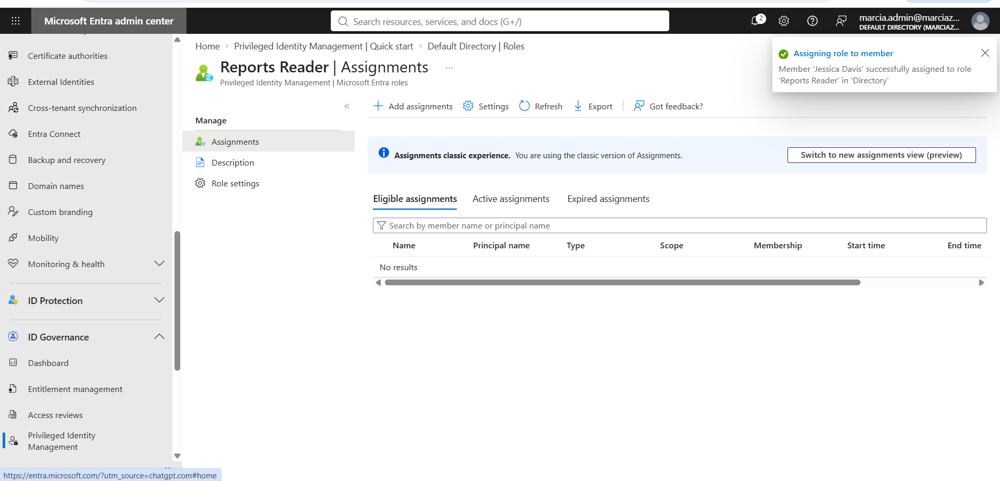

- **Configuration / action demonstrated:** The Entra notification stated that Jessica Davis was assigned to Reports Reader within the directory.
- **Technical explanation and business relevance:** Shows that the assignment operation was accepted instead of remaining in an unsubmitted form.
- **Evidence verified / limitation:** The table had not refreshed yet; this alone was not considered final state verification.

### Evidence 09 — Eligible Assignment Recorded

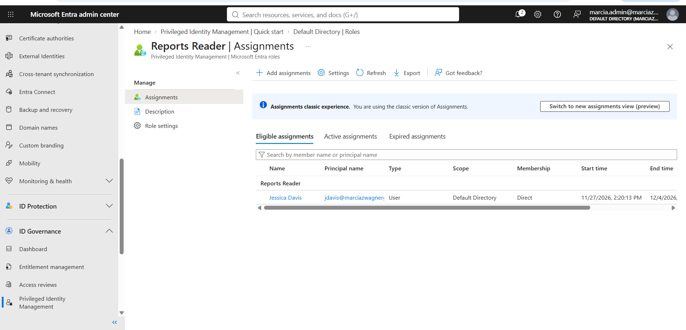

- **Configuration / action demonstrated:** After refreshing, Reports Reader → Eligible assignments listed Jessica Davis, scope Default Directory, direct membership, and December 4 expiration.
- **Technical explanation and business relevance:** Read-back confirmation is the definitive evidence that the intended eligible assignment exists.
- **Evidence verified / limitation:** An eligible assignment is not an active Reports Reader session.

### Evidence 10 — End User Eligible Role Visible

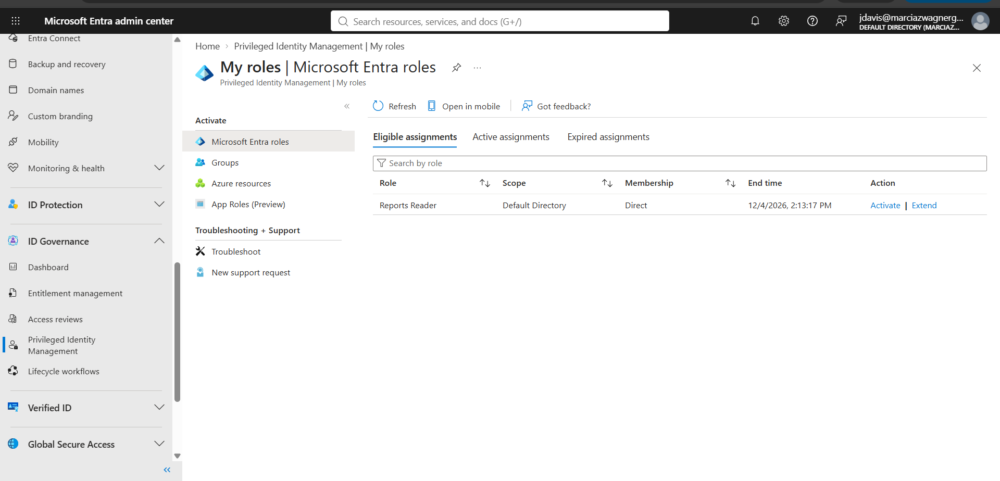

- **Configuration / action demonstrated:** Signed into a separate session as Jessica Davis and confirmed Reports Reader was visible under My roles → Eligible assignments, with an Activate action.
- **Technical explanation and business relevance:** Demonstrates separation between the administrator who assigned eligibility and the user who requests temporary access.
- **Evidence verified / limitation:** This screen establishes end-user eligibility before activation, not effective role activation.

### Evidence 11 — End User Activation Form

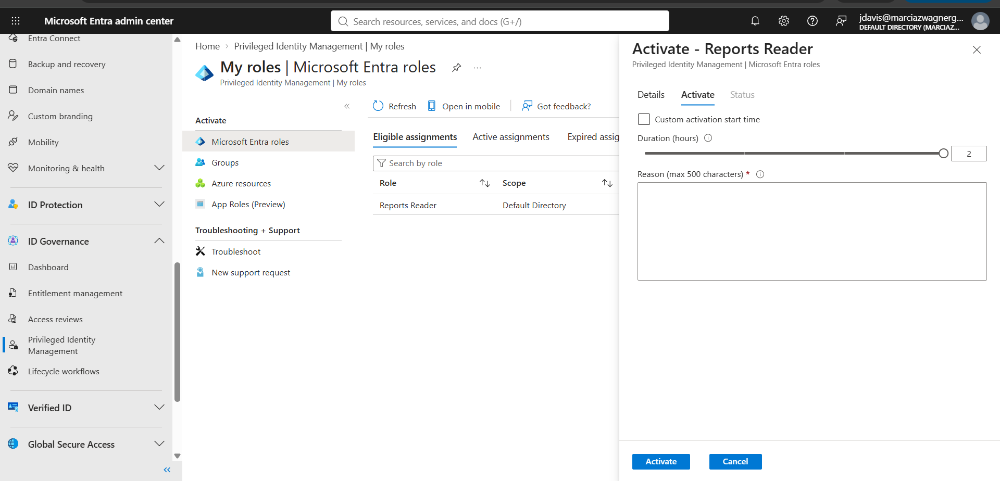

- **Configuration / action demonstrated:** The end-user activation form displayed a two-hour duration and a required Reason field. A work-related training audit justification was used for the activation request.
- **Technical explanation and business relevance:** Just-in-time access should be supported by a stated purpose and a bounded activation window.
- **Evidence verified / limitation:** The screenshot confirms the UI fields. MFA was configured in the policy, but no separate activation challenge was captured.

### Evidence 12 — Activation Completed Successfully

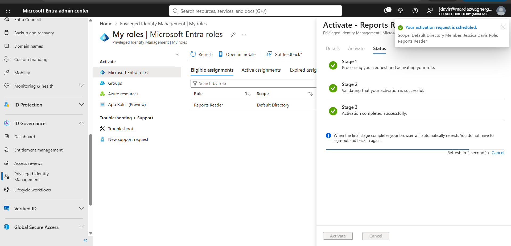

- **Configuration / action demonstrated:** The activation status panel showed three successful stages: processing, validation, and activation completion for Reports Reader.
- **Technical explanation and business relevance:** Shows that a user who held eligible—not standing active—access could request activation through the documented workflow.
- **Evidence verified / limitation:** This proves the portal reported completion; active assignment details were independently checked next.

### Evidence 13 — Temporary Active Role Verified

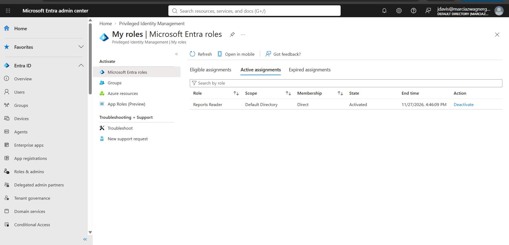

- **Configuration / action demonstrated:** Jessica’s Active assignments list showed Reports Reader in Activated state, with a November 27, 2026, 4:46:09 PM expiration.
- **Technical explanation and business relevance:** Confirms temporary elevation and the scheduled end to the active privilege, rather than indefinite role membership.
- **Evidence verified / limitation:** The two-hour end time is visible, but actual report-reading activity was not separately tested.

### Evidence 14 — Administrator Change Audit History

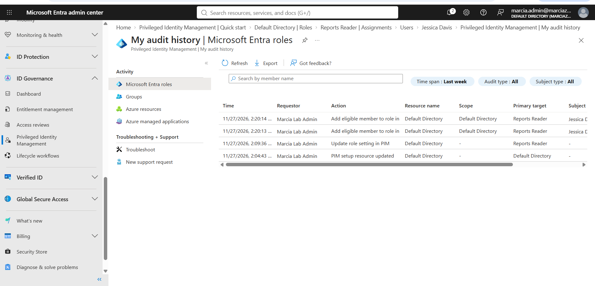

- **Configuration / action demonstrated:** Reviewed administrator audit history showing the PIM policy update and eligible-role assignment actions by Marcia Lab Admin.
- **Technical explanation and business relevance:** Policy and entitlement changes should be attributable and auditable.
- **Evidence verified / limitation:** This is administrator change evidence, not the end-user role activation record.

### Evidence 15 — Resource Audit Activation Events

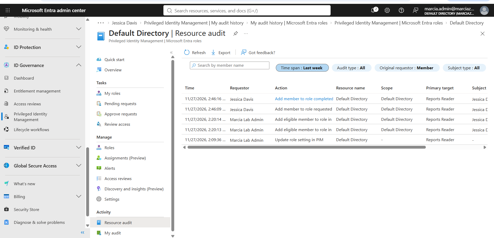

- **Configuration / action demonstrated:** Resource audit showed Jessica Davis requesting and completing Reports Reader activation at approximately 2:46 PM, alongside earlier admin policy and eligibility events.
- **Technical explanation and business relevance:** The audit connects the administrator’s change, eligible entitlement, and member-initiated activation to the same training exercise.
- **Evidence verified / limitation:** Audited event names appear as “Add member to role requested/completed”; their association with the test member and role supports the activation timeline.

### Evidence 16 — PIM Deactivation Completed

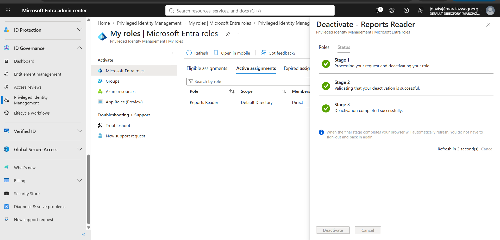

- **Configuration / action demonstrated:** Jessica initiated deactivation of the temporary Reports Reader activation; all three deactivation stages completed successfully.
- **Technical explanation and business relevance:** Role access can be explicitly relinquished before the allowed activation window ends.
- **Evidence verified / limitation:** The following screenshot checks that no active assignment remained.

### Evidence 17 — No Active Assignment After Deactivation

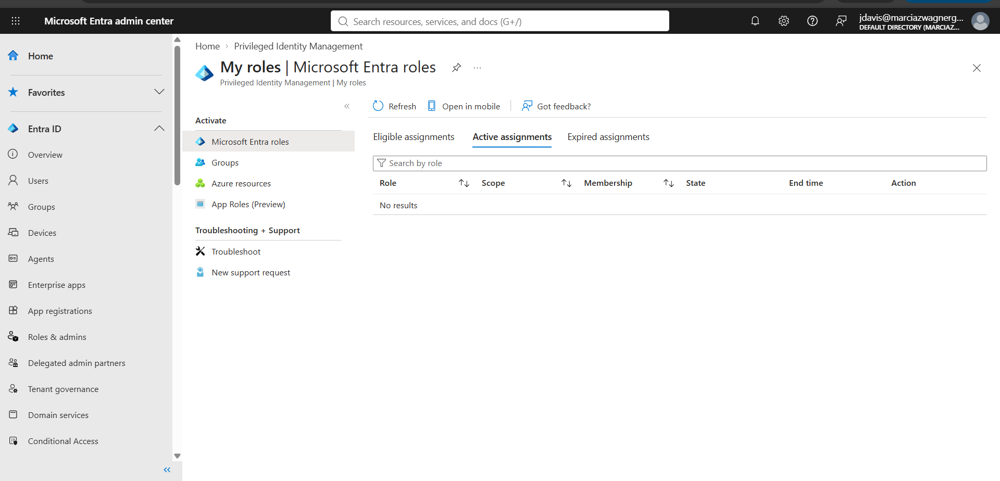

- **Configuration / action demonstrated:** The user’s Active assignments tab displayed No results after deactivation.
- **Technical explanation and business relevance:** Validates removal of the active elevated session rather than relying solely on a success banner.
- **Evidence verified / limitation:** This is the active PIM assignment view for Jessica, not an exhaustive review of every possible entitlement in the tenant.

### Evidence 18 — Eligibility Preserved After Deactivation

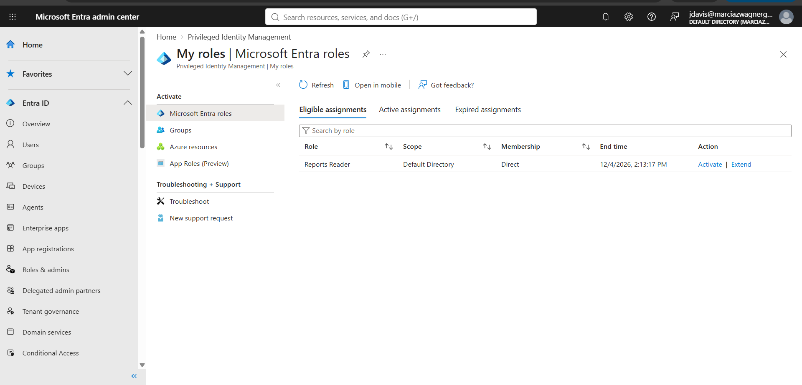

- **Configuration / action demonstrated:** The Eligible assignments tab still displayed Reports Reader, Direct membership and the December 4, 2026 expiration, with Activate available again.
- **Technical explanation and business relevance:** Distinguishes revoking active privilege from removing the underlying eligibility, an important PIM lifecycle concept.
- **Evidence verified / limitation:** Eligible access remains until expiry or administrative removal; deactivation alone does not remove eligibility.

## 6. Controls, Findings, and Risk Interpretation

| Control / finding | Evidence-based conclusion | Remaining consideration |
|---|---|---|
| Eligible vs active role access | An eligible member did not appear as activated until the separate activation workflow completed | Eligibility alone should still be governed and regularly reviewed |
| Short activation window | Saved PIM policy allowed a maximum of two hours and the test activation showed the matching scheduled end time | An actual wait-until-expiry test was not performed; early deactivation was instead verified |
| MFA | Entra activation policy saved as Azure MFA; Jessica also registered Authenticator on sign-in | No distinct activation-time MFA prompt was observed or evidenced |
| Justification | The activation form required a reason and a work-related reason was submitted | Justification quality remains a human review issue; no approval requirement was configured |
| Administrative audit | Policy update and eligible assignment were present in audit history | Audit visibility depends on permissions and retention settings |
| Member activation audit | Resource audit showed requested and completed member-role events for Jessica and Reports Reader | Screenshots were taken during the lab; they are not long-term exported log retention evidence |
| Early deactivation | PIM showed deactivation completed and Jessica’s active-role tab showed no results | The underlying eligible assignment remained in place, intentionally |
| Expiring eligibility | Eligible assignment ended December 4, 2026 in the assigned policy | Actual expiration at that future date was not observed during this exercise |

## 7. Skills Demonstrated

- Microsoft Entra Privileged Identity Management navigation and role inventory analysis
- Role activation policy assessment, configuration, saving, and independent read-back
- Just-in-time authorization: eligible assignments vs temporary active role grants
- Time-bound eligibility, end-user activation, and session duration enforcement configuration
- MFA activation-policy configuration and accurate distinction between policy and observed challenge
- Audit interpretation across administrator and resource views
- Least-privilege role selection and early deactivation validation
- Evidence-based technical documentation with explicit test limitations

## 8. Lessons Learned

1. **Eligibility is not activation.** An account can retain permission to request a role without currently exercising the role’s access.
2. **Audit all transitions.** A complete IAM narrative should connect policy changes, initial eligibility, activation request, completed activation, and deactivation.
3. **Independent verification matters.** A success toast was followed by a refreshed assignment view or policy read-back; a completed deactivation was followed by an empty Active assignments list.
4. **Configuration is not end-to-end proof.** Selecting Azure MFA in a saved policy does not, by itself, demonstrate an observed MFA challenge at every activation.
5. **The cleanup is part of the project.** Deactivation removed the temporary active access while keeping the limited-duration eligible entitlement, which was the intended result.

## 9. Training Environment & Privacy

All identities and the directory were used in an isolated training environment. The images retain the Entra management interface and relevant fictional lab identifiers. Browser tabs and address bars were removed to avoid exposing unrelated open pages. No passwords, QR enrollment codes, or secrets are included. No claims are made of production access or of unaudited deployment activity.
