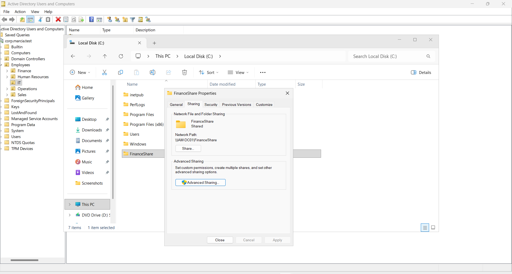
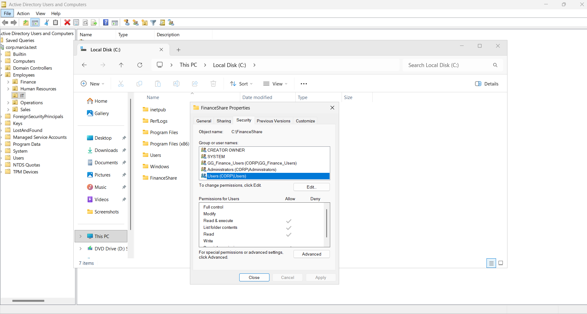
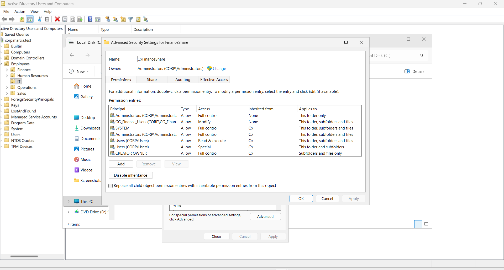
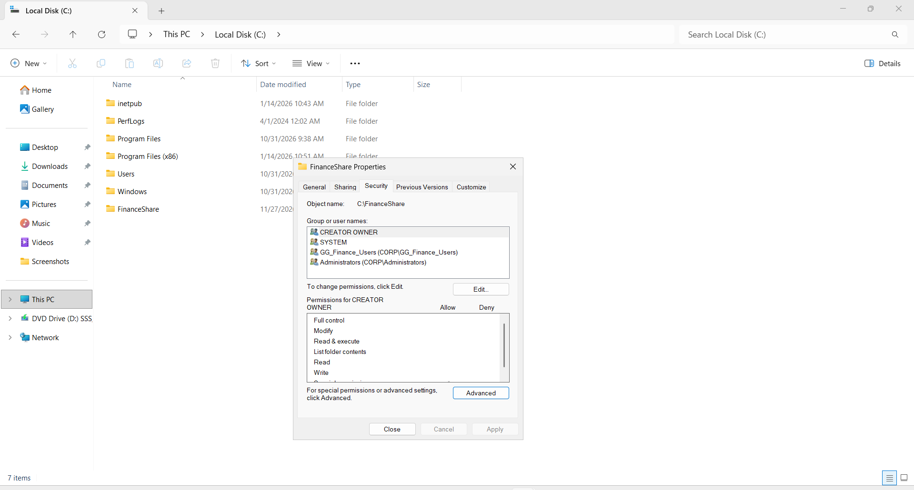
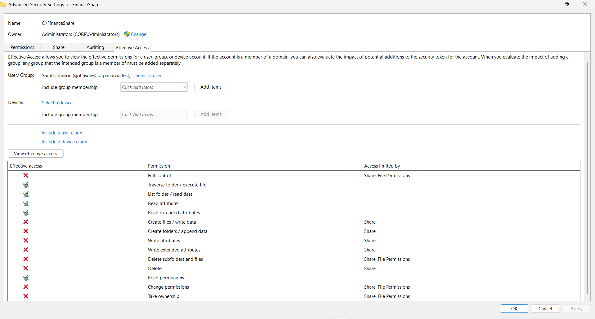
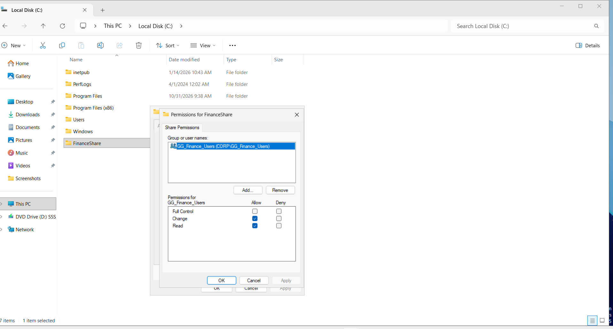
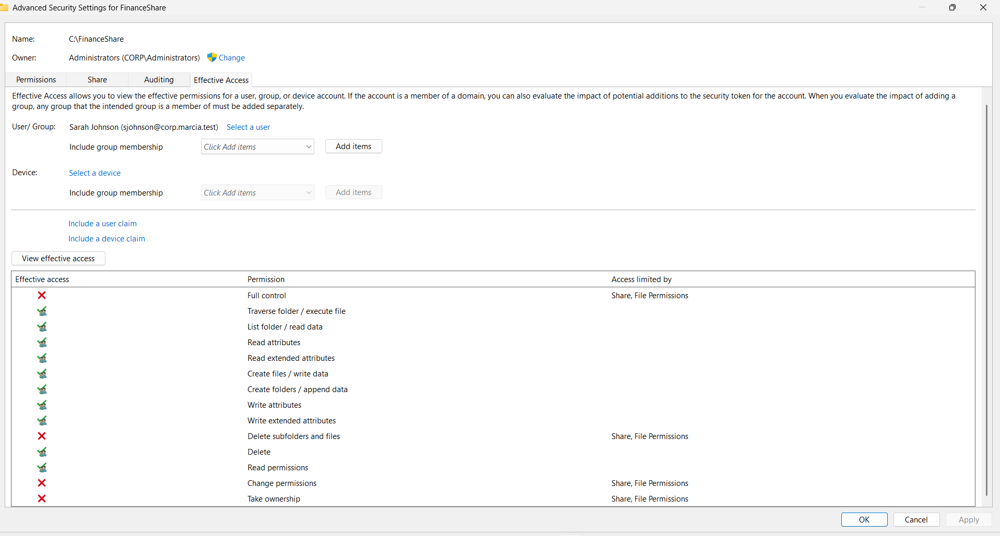
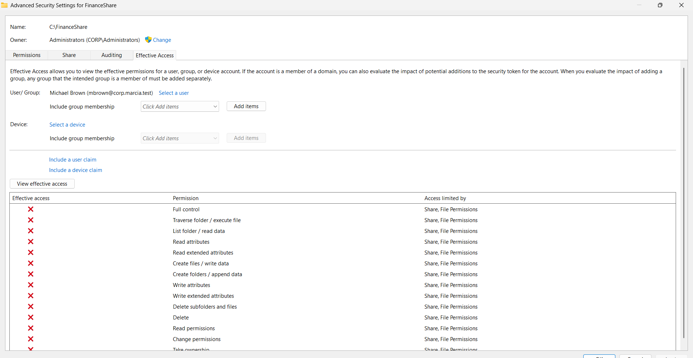

# Lab 07 — Network File Shares & Permissions

**Windows Server | Active Directory Security Groups | SMB Sharing | NTFS Permissions | Effective Access | Least Privilege**

**Status:** Hands-on configuration and Windows Effective Access checks completed November 27, 2026.  
**Lab environment:** Existing Windows Server VM `IAM-DC01`, training domain `corp.marcia.test`.  
**Resource:** Local folder `C:\FinanceShare` shared as `\\IAM-DC01\FinanceShare`.  
**Finance authorization group:** `GG_Finance_Users`.  
**Test identities:** Sarah Johnson (Finance) and Michael Brown (IT).  
**Evidence:** Eight original, taskbar-cropped screenshots with individual technical commentary. No production systems were involved.

## 1. Executive Summary

In this focused IAM lab, I configured an SMB file share intended for Finance personnel, linked access to an existing Active Directory security group, and inspected both share-level and NTFS access control lists (ACLs). I discovered that broadly inherited `CORP\Users` NTFS permissions were inappropriate for a Finance-restricted folder and remediated them without removing essential administrator and system entries.

During verification, I discovered a second, separate issue: Sarah Johnson's initial Effective Access calculation allowed reading but blocked writing because the **share permissions** still granted `Everyone` **Read** only, and the Finance group was absent from the saved share ACL. After correcting and rechecking the share ACL, Windows Effective Access showed the expected limited Modify capabilities for Sarah and no calculated access for an unrelated IT user, Michael Brown.

**Verification boundary:** This project demonstrates saved permission configuration and Windows **Effective Access calculations**. It does **not** claim a live SMB connection, successful file creation over the network, or a denial from an actual non-Finance client session. The server doubles as a domain controller in an isolated lab; a departmental file server would ordinarily be separated from domain controllers in production.

## 2. Business Scenario and Security Objective

A fictional company needs to protect departmental Finance files while still allowing authorized staff to maintain documents. The IAM analyst must ensure permissions follow group membership, avoid broad access for unrelated users, and preserve the operating system and administrator rights needed for maintenance.

The project objectives were to:

- Share an isolated Finance folder using SMB.
- Authorize the existing `GG_Finance_Users` group using **share Read + Change** and **NTFS Modify** (not Full Control).
- Identify and remove unnecessarily broad NTFS entries originating from the parent `C:\` folder.
- Compare the calculated effective rights of a Finance user and a non-Finance IT user.
- Troubleshoot where NTFS and share settings disagree; verify the corrected state.

## 3. Implementation and Results

| Security element | Observed final configuration or result |
|---|---|
| Local folder | `C:\FinanceShare` |
| SMB path | `\\IAM-DC01\FinanceShare` |
| Share ACL | `GG_Finance_Users`: Allow **Read** and **Change**, not Full Control; `Everyone` removed |
| NTFS ACL | `GG_Finance_Users`: Allow **Modify**; Administrators and SYSTEM: Full Control; CREATOR OWNER: Full Control on child items |
| NTFS remediation | Removed two previously inherited `CORP\Users` entries (Read & execute, and Special) from **FinanceShare only** |
| Sarah Johnson (Finance) | Effective Access calculation showed Read, Create, Write, and Delete allowed; Full Control, permission changes, and ownership changes not allowed |
| Michael Brown (IT) | Effective Access calculation showed no listed file access rights to FinanceShare |
| Network client access test | Not conducted; no separate domain-joined client or live SMB sign-in was used |

**Interpretation:** NTFS permissions and share permissions both matter for accessing files over a network. An apparently correct NTFS configuration did not by itself guarantee the expected effective file operations: the saved share ACL initially imposed a stricter Read-only limit. The separate read-back and retest found and corrected that discrepancy.

## 4. Evidence Gallery — Eight Screenshots

Each item includes **what was shown**, **why it matters**, and **what it does not prove**. Click an image in GitHub to inspect the full-resolution evidence.

### Evidence 01 — Finance Network Share Created

- **Observed:** Windows folder Properties displayed `C:\FinanceShare` as Shared with network path `\\IAM-DC01\FinanceShare`.
- **Technical significance:** Confirms the SMB share exists and identifies its intended resource path; the share must still be secured at both share and file-system layers.
- **Verification limit:** A published UNC path is not proof that a remote client can connect.

### Evidence 02 — Broad Users NTFS Access Baseline

- **Observed:** The Security tab listed `CORP\Users`, with Read & execute, List folder contents, and Read checked.
- **Technical significance:** An overly broad domain users principal on a confidential departmental folder is an access-control concern, even where share-level access may also constrain network use.
- **Verification limit:** This screenshot shows the NTFS view, not an end-to-end network access test or every possible effective group membership.

### Evidence 03 — Inherited ACL From Parent C: Drive

- **Observed:** Advanced Security Settings showed `CORP\Users` entries for Read & execute and Special inherited from `C:\`, alongside inherited SYSTEM, Administrators, and CREATOR OWNER entries. The Finance group had an explicit Modify entry.
- **Technical significance:** Pinpoints the *source* of the broad NTFS access. Permission inheritance must be managed at the child folder rather than changing `C:\` and potentially affecting unrelated resources.
- **Verification limit:** The Special entry's granular rights were not expanded in the screenshot; the record establishes its presence and inheritance, not every underlying flag.

### Evidence 04 — Remediated NTFS ACL

- **Observed:** Following conversion of inherited permissions to explicit permissions on FinanceShare and removal of the two `CORP\Users` entries, the Security tab listed `GG_Finance_Users`, SYSTEM, Administrators, and CREATOR OWNER.
- **Technical significance:** Preserves privileged maintenance principals while narrowing departmental access to a Finance security group.
- **Verification limit:** The Security tab shows remaining principals; detailed permission inheritance scope had been inspected separately. This change was applied to FinanceShare, not to the system drive root.

### Evidence 05 — Initial Finance Effective Access Restriction

- **Observed:** Effective Access for Sarah Johnson allowed read operations but showed red X marks for Create files, Write, and Delete, with **Share** listed as the limiting layer.
- **Technical significance:** A useful troubleshooting result: the share ACL can be more restrictive than NTFS. The observed outcome contradicted the intended Finance Modify permission and prompted an audit of the persisted share ACL.
- **Verification limit:** This is a Windows calculation, not a file-operation test performed by a signed-in user.

### Evidence 06 — Corrected Finance Share Permissions

- **Observed:** After reopening the share permissions, `GG_Finance_Users` was the listed principal, with Read and Change checked and Full Control unchecked. The previous `Everyone` entry was removed.
- **Technical significance:** Implements group-based share authorization and explains why Sarah's earlier read-only result changed after the ACL correction.
- **Verification limit:** The screenshot captures the share permission dialog; the following Effective Access screenshots verify the expected calculated impact.

### Evidence 07 — Finance User Effective Access Verified

- **Observed:** Windows Effective Access for Sarah Johnson (`sjohnson@corp.marcia.test`) allowed listing/reading, creating files and folders, writing attributes/data, and Delete. Full Control, Delete subfolders and files, Change permissions, and Take ownership were not granted.
- **Technical significance:** Demonstrates the intended departmental least-privilege permission profile after combining share and NTFS settings: staff can perform routine file operations without administering ACLs or taking ownership.
- **Verification limit:** This verifies Windows' calculated rights for the selected identity, not actual SMB connectivity or successful file transfers.

### Evidence 08 — Non-Finance IT User Access Excluded

- **Observed:** Windows Effective Access for Michael Brown (`mbrown@corp.marcia.test`) displayed red X marks for listed read, traverse, create, write, delete, and permission-management operations, with **Share, File Permissions** shown as limiting layers.
- **Technical significance:** Supports departmental separation. Michael belongs to the IT test identity population, not to the Finance access group, and the calculated access result contrasts with Sarah's.
- **Verification limit:** This does not replace a live unauthorized SMB sign-in test or a comprehensive group membership audit.

## 5. Risk Findings and Remediation

| Finding | Evidence | Resolution / result |
|---|---|---|
| Broad inherited access | `CORP\Users` read and special inherited entries on FinanceShare | Disabled inheritance *on the child folder*, converted inherited entries to explicit entries, removed the two broad Users entries, retained SYSTEM/Administrators/CREATOR OWNER |
| Share ACL unintentionally read-only | Initial effective access showed Share limiting writes; subsequent audit showed Everyone: Read | Restored saved share ACL to `GG_Finance_Users`: Read + Change, removed Everyone, and re-ran Effective Access |
| Risk of excessive Finance privileges | Full Control and administrative ACL rights were unnecessary for routine Finance documents | Granted Share Change + Read and NTFS Modify; did not grant Full Control |
| Department boundary | Finance and IT roles require different access | Sarah had calculated routine file operations; Michael's calculated access showed none |

## 6. Skills Demonstrated

- Windows Server SMB file sharing and network UNC paths
- Microsoft Active Directory security groups for resource authorization
- NTFS Discretionary Access Control Lists (DACLs), inheritance, and explicit permissions
- Least-privilege share and file-system permission design
- Diagnosing conflicts between share permissions and NTFS permissions
- Windows Effective Access analysis and comparing identities across departments
- Careful remediation that preserves administrators and system access
- Evidence capture and technically accurate reporting of verification limits

## 7. Lessons Learned

1. **Inspect both permission layers.** NTFS Modify did not overcome a saved share ACL that allowed only Read.
2. **Verify after saving.** A permission setting viewed during editing is not the same as a persisted configuration; reopening the dialog revealed the missing group entry.
3. **Contain remediation.** Inherited broad rights were converted and removed on FinanceShare, not on the `C:\` system drive.
4. **Separate routine work from administration.** Finance needed Modify but not Full Control or ownership/permission management.
5. **Label tests accurately.** Windows Effective Access is strong configuration evidence but does not independently prove successful or denied remote SMB use.

## 8. Privacy and Lab Notes

All names and domain accounts were fictional training identities. Screenshots are original captures cropped to remove the Windows taskbar; no screenshots have been fabricated. The exercise was performed on an existing isolated Windows Server training VM, not on a production file server. No passwords, authentication challenges, or confidential real-world data are included. No live cross-user SMB access session was captured.
